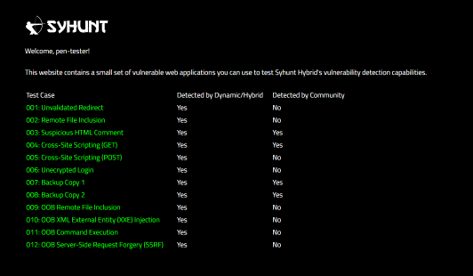
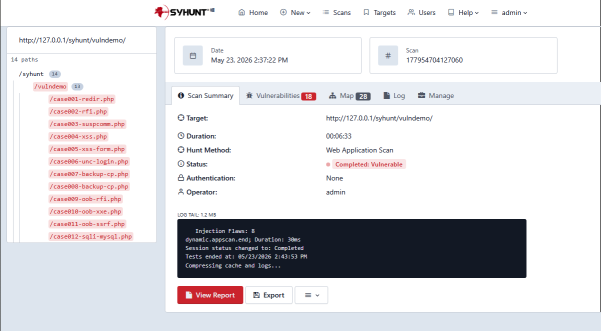
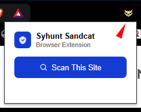
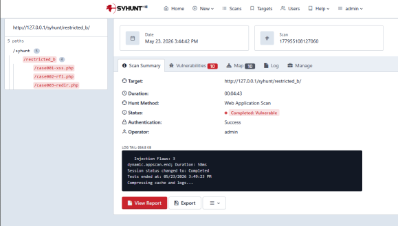
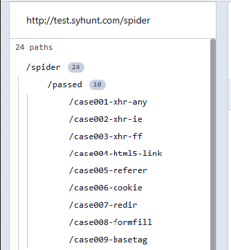
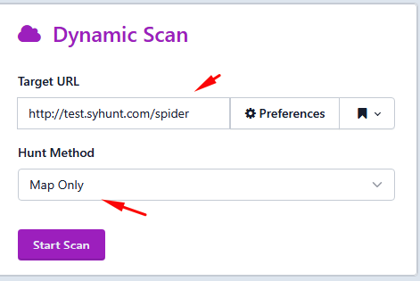
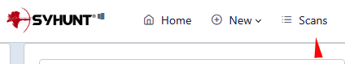
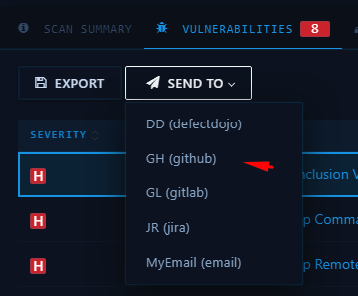
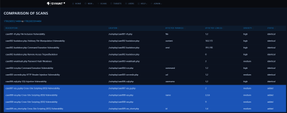

# Proof-of-Concept Test Plan

> **Applies to:** Syhunt Hybrid 7.2

> [!NOTE]
> This test plan was written for **Syhunt Hybrid**, the full-featured edition. Syhunt Community has restricted functionality and vulnerability checks, so some test cases cannot be performed with it and not every vulnerability will be detected.

## Introduction

This test plan verifies the functionality, accuracy and correct operation of every key part of Syhunt Hybrid. It is meant to be carried out on the customer's premises after Syhunt Hybrid has been deployed and activated, and it consists of dynamic and static scans run under various conditions that simulate real-world use. By the end, you will be familiar with the main product features and integration options, and Syhunt will be able to collect your feedback on usability.

### Test cases

| Phase | Test case |
|---|---|
| **1. Dynamic auditing** | [D1: Scan a live website for vulnerabilities](#D1) |
| | [D2: Log in manually through the browser and scan a restricted website](#D2) |
| | [D3: Log in automatically and scan a restricted website](#D3) |
| | [D4: Map a website only (crawling test with JavaScript execution)](#D4) |
| | [D5: Perform an incremental dynamic scan](#D5) |
| | [D6: Perform concurrent dynamic scans](#D6) |
| **2. Source code auditing** | [S1: Scan local source code files](#S1) |
| | [S2: Scan remote Git repositories](#S2) |
| **3. Integration** | [N1: Launch a code scan from the command line](#N1) |
| | [N2: Launch a dynamic scan from the command line](#N2) |
| | [N3: Create a tracker issue from a reported vulnerability](#N3) |
| | [N4: Generate an F5 BIG-IP ASM–compatible export](#N4) |
| **4. Reporting** | [R1: Generate a standard HTML report](#R1) |
| | [R2: Generate a complete HTML report](#R2) |
| | [R3: Export scan results as XML](#R3) |
| | [R4: Edit a reported vulnerability](#R4) |
| | [R5: Generate a comparison report between scans](#R5) |

<a id="envreq"></a>

## Environment requirements

The results in this plan were obtained on Windows 11 x64 with an Intel Core i9, 64 GB of RAM, a 1 TB SSD and Internet access. Make sure you have a fast SSD and Internet access, and that you meet at least the [minimum system requirements](../reference/technical-specifications.md#specsbegin).

The plan assumes Syhunt Hybrid is already installed on the Windows machine that will run the tests, and that the Web UI is enabled. If it isn't:

1. Download the setup executable from the link provided by Syhunt, double-click it and follow the installer (*Next → Next → Finish*). Syhunt Hybrid launches when you click **Finish**.
2. [Enable the Syhunt Web UI](../installation/web-ui.md#firststeps).
3. On the Web UI home page, enter the Pen-Tester Key from the email that contained your download link, and click **Apply**. A success message confirms Syhunt is ready for testing.

<a id="preyserver"></a>

### Prey Server

Prey Server is a portable Apache/PHP web server bundled with a set of intentionally vulnerable web applications for demonstration purposes.

1. Download it from <https://syhunt.fra1.cdn.digitaloceanspaces.com/tools/hybrid_xtras/syhunt-vulnphpserver.zip>.
2. Unzip it to a folder of your choice.
3. Run `PreyServer.exe`.
4. Run `mysql\start.exe` to start the MySQL server.
5. Open <http://127.0.0.1/syhunt/vulndemo> in your browser. You should see the welcome page:



### Git for Windows

The Git-related test cases require [Git for Windows](https://gitforwindows.org/). Install it with the default settings, then confirm that the `git` command works from the Command Prompt.

<a id="scantime"></a>

## Estimated scan times

- **Dynamic scans (phase 1)** take about **5 minutes** each against the recommended targets. The incremental scan in [D5](#D5) takes about half that.
- **Code scans (phase 2)** take about **10 seconds** against the recommended targets. For comparison, a larger Java + JavaScript project of about 200,000 lines takes around 4 minutes, and an incremental rescan of the same codebase takes about half that. In other words, Syhunt analyzes roughly 6 million lines of code per hour, and about 12 million per hour on recurring scans of the same targets.

## Phase 1: Dynamic auditing

<a id="D1"></a>

### D1. Scan a live website for vulnerabilities

**Action:** Scan <http://127.0.0.1/syhunt/vulndemo> for vulnerabilities.

**Expected result:** When the scan completes, the **Vulnerabilities** tab lists every test case, from 001 to 012.

[](https://www.syhunt.com/pub/screenshots/poctestplan/d1.png)

**Steps:**

1. Make sure Prey Server is running (see [Prey Server](#preyserver)).
2. Open the Syhunt Hybrid home page, `https://127.0.0.1:8018/syhunt/`, and click Dynamic's **New Scan** button.<br>
3. Enter `http://127.0.0.1/syhunt/vulndemo` as the target URL.<br>
4. Select the **Application Scan (Default)** hunt method, which checks for all vulnerabilities using the recommended settings.
5. Click **Start Scan**.

<a id="D2"></a>

### D2. Log in manually through the browser and scan a restricted website

**Action:** Scan <http://127.0.0.1/syhunt/restricted>, which uses web form authentication.

**Expected result:** When the scan completes, the **Vulnerabilities** tab lists every test case, from 001 to 003.

[](https://www.syhunt.com/pub/screenshots/poctestplan/d2.png)

**Steps:**

1. Make sure Prey Server is running (see [Prey Server](#preyserver)).
2. Make sure the [Syhunt Sandcat](../installation/install-windows.md#sandcat) browser extension is enabled.
3. In your browser, go to <http://127.0.0.1/syhunt/restricted>.
4. Log in with username **test** and password **CUBPzjVy**.
5. Click the Syhunt Sandcat icon in the browser toolbar, then **Scan This Site**.<br>
6. A screen with a screenshot of the website and a green **Session Ready** message appears.
7. Select the **Application Scan (Default)** hunt method.
8. Click **Start Scan**.

<a id="D3"></a>

### D3. Log in automatically and scan a restricted website

**Action:** Scan <http://127.0.0.1/syhunt/restricted_b>, which uses HTTP Basic authentication.

**Expected result:** When the scan completes, the results list every test case, from 001 to 003.

[](https://www.syhunt.com/pub/screenshots/poctestplan/d3.png)

**Steps:**

1. Make sure Prey Server is running (see [Prey Server](#preyserver)).
2. Open `https://127.0.0.1:8018/syhunt/` and click Dynamic's **New Scan** button.<br>
3. Enter `http://127.0.0.1/syhunt/restricted_b` as the target URL.<br>
4. Select the **Application Scan (Default)** hunt method.
5. Click **Preferences**.<br>
6. On the **Authentication** tab, set **Authentication** to **Basic**.
7. Enter username **test** and password **test**, then click **Save**.
8. Click **Start Scan**.

<a id="D4"></a>

### D4. Map a website only (crawling test with JavaScript execution)

**Action:** Crawl <http://test.syhunt.com/spider>.

**Expected result:** When the scan completes, expanding the site tree in the left sidebar shows the site structure, including every test case from 001 to 009 under the `/passed/` directory.



**Steps:**

1. Open `https://127.0.0.1:8018/syhunt/` and click Dynamic's **New Scan** button.<br>
2. Enter `http://test.syhunt.com/spider` as the target URL.<br>
3. Select the **Spider Only** hunt method.
4. Click **Start Scan**.

<a id="D5"></a>

### D5. Perform an incremental dynamic scan

**Action:** Scan <http://127.0.0.2/syhunt/vulndemo> twice.

**Expected result:** The first scan takes about 4 minutes; the second takes about half that (around 2 minutes). After each scan, the results list every test case, from 001 to 012.

[](https://www.syhunt.com/pub/screenshots/poctestplan/d5.png)

**Steps:**

1. Follow the steps in [D1](#D1), but use `127.0.0.2` instead of `127.0.0.1` as the target, since incremental scanning is not enabled for `127.0.0.1`.
2. Repeat the same steps to scan `127.0.0.2` a second time.

<a id="D6"></a>

### D6. Perform concurrent dynamic scans

**Action:** Run two simultaneous scans against <http://127.0.0.1/syhunt/vulndemo>.

**Expected result:** When the scans complete, the **Vulnerabilities** tab of each scan lists every test case, from 001 to 012. The right sidebar shows the status of each scan, marked in red.

[](https://www.syhunt.com/pub/screenshots/poctestplan/d6.png)

**Steps:**

1. Follow the steps in [D1](#D1).
2. Before the scan ends, return to the Syhunt Hybrid home screen and repeat steps 2 to 5 of [D1](#D1) to start a second scan against the same target.

## Phase 2: Source code auditing

<a id="S1"></a>

### S1. Scan local source code files

**Action:** Launch a code scan against a local archive from the user interface.

**Expected result:** When the scan completes, the **Vulnerabilities** tab lists every test case, from 001 to 009.

**Steps:**

1. Download <https://github.com/syhunt/vulnphp/archive/master.zip> with your browser.
2. Open the Syhunt Hybrid home page and click Code's **New Scan** button.<br>
3. On the **File** tab, click **Choose File** and select the `master.zip` file you downloaded.
4. Make sure the **Code Scan (Default)** hunt method is selected.
5. Click **Start Scan**.

You can repeat this test with vulnerable samples in other languages (the number of test cases varies by archive):

| Language | Archive |
|---|---|
| Java | <https://github.com/syhunt/vulnjava-wavsep/archive/master.zip> |
| Lua | <https://github.com/syhunt/vulnlua/archive/master.zip> |
| PHP | <https://github.com/syhunt/vulnphp/archive/master.zip> |

<a id="S2"></a>

### S2. Scan remote Git repositories

**Action:** Launch a code scan against a remote Git repository.

**Expected result:** When the scan completes, the results list every test case, from 001 to 009.

**Steps:**

1. Open the Syhunt Hybrid home page and click Code's **New Scan** button.<br>
2. Enter `https://github.com/syhunt/vulnphp.git` as the project URL.
3. Make sure the **Code Scan (Default)** hunt method is selected.
4. Click **Start Scan**.

You can repeat this test with repositories in other languages (the number of test cases varies by repository):

| Language | Repository |
|---|---|
| Java | `https://github.com/syhunt/vulnjava-wavsep.git` |
| Lua | `https://github.com/syhunt/vulnlua.git` |
| PHP | `https://github.com/syhunt/vulnphp.git` |

## Phase 3: Integration

<a id="N1"></a>

### N1. Launch a code scan from the command line

**Action:** Scan <https://github.com/syhunt/vulnphp> from the command-line interface.

**Expected result:** When the scan completes, the results list every test case, from 001 to 009.

**Steps:**

1. Open a Command Prompt in the Syhunt Hybrid installation folder (see [Command Line](../integrations/command-line.md#intro)).
2. Run:

   ```
   scancode https://github.com/syhunt/vulnphp.git
   ```

<a id="N2"></a>

### N2. Launch a dynamic scan from the command line

**Action:** Scan <http://127.0.0.1/syhunt/vulndemo> from the command-line interface.

**Expected result:** When the scan completes, the results list every test case, from 001 to 012.

**Steps:**

1. Make sure Prey Server is running (see [Prey Server](#preyserver)).
2. Open a Command Prompt in the Syhunt Hybrid installation folder (see [Command Line](../integrations/command-line.md#intro)).
3. Run:

   ```
   scanurl 127.0.0.1/syhunt/vulndemo
   ```

<a id="N3"></a>

### N3. Create a tracker issue from a reported vulnerability

**Action:** Create a GitHub issue from a reported vulnerability.

**Expected result:** After you add a GitHub connector and submit a vulnerability, the vulnerability appears as an issue in your GitHub repository.

**Steps:**

1. Create a GitHub account if you don't have one, and create a test repository.
2. Add a GitHub connector in Syhunt as described in [Issue Trackers](../integrations/issue-trackers.md).
3. Open **Scans** from the menu.<br>
4. Click a scan with status **Vulnerable** and switch to the **Vulnerabilities** tab.
5. Select the vulnerability you want to send to GitHub.
6. Click **Send To → *your connector name*** to submit it.<br>

<a id="N4"></a>

### N4. Generate an F5 BIG-IP ASM–compatible export

**Action:** Generate an ASM export file for a scan.

**Expected result:** After you click **Download**, the browser opens the compatible XML file, which you can then import into BIG-IP ASM.

**Steps:**

1. Open **Scans** from the menu.<br>
2. Right-click a scan with status **Vulnerable** and choose **Generate Report**.
3. Select the **Complete** report template.
4. Set **Format** to **XML ASM generic scanner format**.
5. Click **Generate**, then **Download**.

## Phase 4: Reporting

<a id="R1"></a>

### R1. Generate a standard HTML report

**Action:** Generate a report for a scan, sorting vulnerabilities by CVSS 3.

**Expected result:** After you click **Generate**, the browser lets you download the HTML report.


**Steps:**

1. Open **Scans** from the menu.<br>
2. Click a scan with status **Vulnerable**, switch to the **Vulnerabilities** tab and click **Export**.
3. Select the **Standard** report template, if it isn't already selected.
4. Select the **CVSS** sorting method, if it isn't already selected.
5. Click **Generate** (bottom-left corner of the tab), then **Download**.

<a id="R2"></a>

### R2. Generate a complete HTML report

**Action:** Generate a complete report for a scan, sorting vulnerabilities by CVSS 3.

**Expected result:** After you click **Generate**, the browser lets you download the HTML report.

**Steps:**

1. Open **Scans** from the menu.<br>
2. Click a scan with status **Vulnerable**, switch to the **Vulnerabilities** tab and click **Export**.
3. Select the **Complete** report template.
4. Select the **CVSS** sorting method, if it isn't already selected.
5. Click **Generate** (bottom-left corner of the tab), then **Download**.

<a id="R3"></a>

### R3. Export scan results as XML

**Action:** Generate an XML results file for a scan.

**Expected result:** After you click **Download**, the browser lets you download the XML results file.


**Steps:**

1. Open **Scans** from the menu.<br>
2. Click a scan with status **Vulnerable**, switch to the **Vulnerabilities** tab and click **Export**.
3. Select the **Complete** report template.
4. Set the output format to **XML**.
5. Click **Generate**, then **Download**.

<a id="R4"></a>

### R4. Edit a reported vulnerability

**Action:** Edit the details of a reported vulnerability.

**Expected result:** The vulnerability edit screen opens. After you save your changes, any report you generate includes the edited information.


**Steps:**

1. Open **Scans** from the menu.<br>
2. Click a scan with status **Vulnerable** and go to the **Vulnerabilities** tab.
3. Click a vulnerability. Its details screen opens.
4. On the **Notes** tab, add some notes.
5. Click **Save**.

<a id="R5"></a>

### R5. Generate a comparison report between scans

**Action:** Generate a report comparing two scans.

**Expected result:** The generated report matches the comparison screen and lists test cases 007 to 009 as removed.

[](https://www.syhunt.com/pub/screenshots/poctestplan/r5.png)

**Steps:**

1. Follow the steps in [S1](#S1), but extract the archive to a folder and scan the folder.
2. When the scan completes, delete test cases 007 to 009 from that folder.
3. Scan the folder again.
4. Open **Scans** from the menu.<br>
5. Select the two most recent scans and click **Compare** at the top of the screen.<br>
