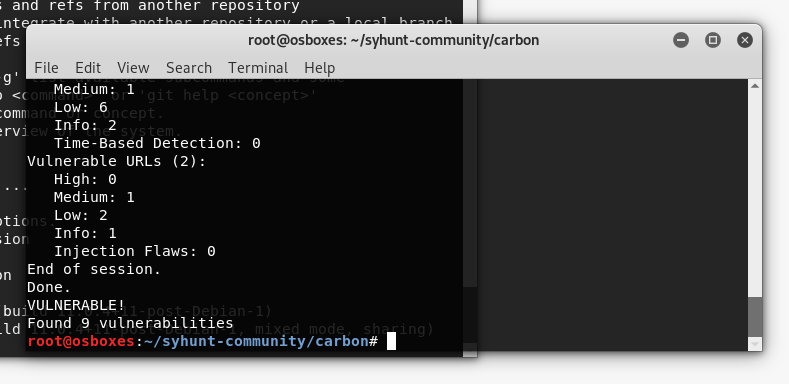

# Installation Overview and Windows

> **Applies to:** Syhunt Hybrid 7.2

**Contents**

- [Introduction](#intro)
- [Windows vs. Linux/macOS editions](#versions)
- [Installing on Windows](#windows)
- [Installing on macOS](#mac)
- [Installing on Linux](#linux)
- [Installing the Syhunt Sandcat browser extension](#sandcat)
- [System requirements](#sysreq)
- [Internet connection requirements](#sysreq_net)
- [Updating Syhunt](#update)
- [Uninstalling Syhunt](#uninstall)

<a id="intro"></a>

## Introduction

Syhunt Hybrid 7 is a 64-bit, multi-platform application security scanner. It runs on Windows, macOS and Linux distributions such as Ubuntu Desktop/Server, Debian and Fedora with almost no setup effort. Syhunt Hybrid performs web and mobile application security testing (DAST and SAST) and integrates with a variety of systems for continuous integration and scanning.



<a id="versions"></a>

### Windows vs. Linux/macOS editions

| | **Hybrid for Windows** | **Hybrid for Linux/macOS** |
|---|---|---|
| Web UI server | OpenResty for both HTTPS and HTTP | NGINX for HTTPS, OpenResty as back end |
| Deep AJAX crawler | ✅ Chromium engine | ✅ Firefox engine |
| Augmented dynamic analysis (DAST + OAST) | ✅ | ✅ |
| API analysis (AAST + OAST) | ✅ | ✅ |
| Web application source code analysis (SAST) | ✅ | ✅ |
| Mobile application source code analysis (MAST) | ✅ | ✅ |
| Forensic analysis (FAST) | ✅ (CLI only) | ✅ (CLI only) |
| AI-powered capabilities | ✅ Patched code examples<br>✅ AI confidence score | ✅ Patched code examples<br>✅ AI confidence score |
| Advanced authentication | ✅ Recorder, Selenium | ✅ Recorder, Selenium |
| Integrations | ✅ Shell ([PowerShell](../integrations/powershell.md))<br>✅ Issue trackers (GitHub, GitLab, Jira…)<br>✅ CI/CD tools (GitLab, GitHub, Bitbucket, Jenkins)<br>✅ WAFs for virtual patching<br>✅ Azure DevOps / TFS project URLs (non-Git) | ✅ Shell (Bash)<br>✅ Issue trackers (GitHub, GitLab, Jira…)<br>✅ CI/CD tools (GitLab, GitHub, Bitbucket, Jenkins)<br>✅ WAFs for virtual patching<br>✅ Azure DevOps / TFS project URLs (non-Git) |
| Scan scheduler | ✅ | ✅ |
| Supported operating systems | **Officially:**<br>Windows 11<br>Windows 10<br>Windows Server 2016 to 2025 | **Officially:**<br>macOS Sequoia 15.4.1 or later (Apple Silicon)<br>Ubuntu Server/Desktop 18.10 and later<br>Debian 9 and later<br>Fedora 32 and later<br>**Unofficially (successfully tested):**<br>[Other Linux distributions](../reference/technical-specifications.md#linuxcompat_begin)<br>macOS Monterey |
| Availability | [Available now](#windows) (native Win64 binaries) | [Available now](#linux) (Wine-powered installation)<br>[Ask about native binaries](https://www.syhunt.com/en/?n=Syhunt.ContactUs) for your distribution |

<a id="windows"></a>

## Installing on Windows

**Registered customers:** follow the initial steps in the [Welcome Guide](../getting-started/welcome-guide.md) to download, install and start using the full version of Syhunt Hybrid. Non-registered users can use Syhunt Community.

1. *(Optional)* If you plan to scan Git repositories, install [Git for Windows](https://gitforwindows.org/).
2. Download the Syhunt Hybrid setup, `syhunt-hybrid-<version>.exe`.
3. Double-click the downloaded file to run it.
4. Read the EULA carefully before accepting it.
5. Complete the installer (*Next → Next → Finish*). When you click **Finish**, Syhunt launches and the Launcher screen appears.
6. If needed, [enable the Syhunt Web UI](web-ui.md#firststeps).

**What's next?** Read the [Quick Start](../getting-started/quick-start.md) and the [integration guides](../README.md#integrations).

<a id="mac"></a>

## Installing on macOS

See the [macOS installation guide](install-macos.md).

<a id="linux"></a>

## Installing on Linux

Syhunt Hybrid for Linux is the *Carbon* edition: a Wine-powered installation compatible with most 64-bit Linux desktops and servers. See the [Linux installation guide](install-linux.md) for distribution-specific steps.

<a id="sandcat"></a>

## Installing the Syhunt Sandcat browser extension

Since version 7.2, Syhunt Hybrid includes a browser extension for Edge, Chrome, Brave and other Chromium-based browsers. It enables [manual login](../scanning/authenticated-scanning.md#auth_manual) and browser-assisted testing. The name honors the Sandcat Browser, the built-in browser in Syhunt 7.1 and earlier, which supported manual login in a similar way.

1. In your browser, open **Menu → Extensions → Manage Extensions**.
2. Turn on **Developer mode** (top-right corner).
3. Click **Load unpacked** and select the Sandcat extension folder:
   - Windows: `C:\Program Files\Syhunt Hybrid\Extensions\SandcatExtension`
   - Linux: `/home/<user>/syhunt-hybrid/carbon/sandcat`
   - macOS: `/Applications/Syhunt Hybrid/carbon/sandcat`
4. Syhunt Sandcat now appears in your list of extensions.
5. Open the Web UI home page again. The message **Extension detected and ready** confirms that everything works.

If you reach the Web UI through an IP address, domain or subdomain other than `localhost`, configure its address in the extension:

1. Click the extension's **Details** button, then **Extension options**.
2. Select **Use custom Syhunt UI origin**.
3. Choose the protocol (`http` or `https`).
4. Enter the host, *without* the protocol prefix (`http://` or `https://`).
5. Enter the port used by the Web UI.
6. Click **Save**.
7. Open the Web UI home page again and check for the **Extension detected and ready** message.

<a id="sysreq"></a>

## System requirements

See [Technical Specifications](../reference/technical-specifications.md#specsbegin).

<a id="sysreq_net"></a>

### Internet connection requirements

The machine running Syhunt must be able to make HTTP(S) requests to the following addresses:

| Domain | Ports | Purpose |
|---|---|---|
| Your target domain(s) | 80, 443\* | The domain hosting the web application or codebase you want to scan. |
| Any or specific asset domains | 80, 443 | Optional but recommended: lets Syhunt analyze externally hosted JavaScript files and assets during DAST or SAST. |
| `syhunt.fra1.cdn.digitaloceanspaces.com` | 443 | Required: installation and auto-update assets. |
| `www.syhunt.net` | 80, 443 | Required: assets for HTML/PDF reports, update notifications, auto-update and more. |
| `signal.syhunt.net` | 80, 443 | Required during DAST to perform OAST (important). |
| `api.openai.com` | 443 | Optional: AI-powered features. |
| `fonts.googleapis.com` | 80, 443 | Required: fonts for HTML/PDF reports. |
| `www.google.com` | 443 | Required: Google JSAPI for HTML/PDF reports. |
| `www.gstatic.com` | 443 | Required: Google JSAPI for HTML/PDF reports. |

\* If your target uses a non-standard port (such as 8080), or you connect to Git over SSH or another protocol, allow those ports as well.

> [!WARNING]
> If you use a personal firewall, allow Syhunt to make outbound Internet connections.

<a id="finishinstall"></a>

On Linux and macOS, the setup is a Java installer. See [Running the setup](install-linux.md#finishinstall).

<a id="update"></a>

## Updating Syhunt

Updates can be downloaded and installed from the Syhunt website. Syhunt Hybrid 6.8.4 and later also announce new releases in the Launcher and in reports.

On Linux and macOS, run `scanupdate` to check for updates; if any are available, Syhunt asks whether to download and install them. Run `scanupdate auto` to install available updates without asking for confirmation.

You don't need to uninstall Syhunt before installing a new version, except when updating Syhunt Community CLI on Windows.

<a id="uninstall"></a>

## Uninstalling Syhunt

**Windows:** use the uninstall shortcut in the Start menu (under the *Syhunt Hybrid* or *Syhunt Community* folder), or remove Syhunt from **Control Panel → Programs and Features**.

**Linux and macOS:** go to the folder where Syhunt is installed and run:

```
java -jar Uninstall.jar
```
