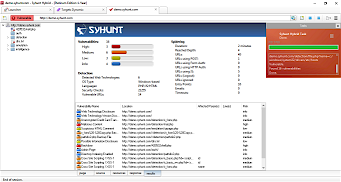

# Migration Notes

Read the notes for every version between your current release and the one you are installing.

## Migrating to Syhunt 7.2

- **The classic desktop interface has been retired.** The desktop UI shown below is no longer included; it has been replaced by the redesigned Web UI.

  

- **Feature parity on Linux.** Features previously available only on Windows, such as Selenium-based authentication and the Deep AJAX crawler, are now available on Linux too.
- **Forensic Scanner is CLI-only.** Use the `scanlog` command. A future update will let you view forensic scan results in the Web UI.
- **Review your targets.** Open the [Targets screen](https://127.0.0.1:8018/syhunt/?n=targets) and look for warning icons next to any target. Hover over an icon to see which preferences or settings need attention. In particular:
  - The **Selenium-Py** authentication method is deprecated. Switch to one of the new methods: Smart, Recorder, Selenium-Auto or Selenium-JS.
  - **AI-Powered Login** has been discontinued. Switch to Smart, Recorder or Selenium-Auto.
- **Plus extensions are built in.** You no longer need to install the separate Plus extensions setup; the 7.2 installer includes every required component.

## Migrating to Syhunt 7.0

On Windows Server, make sure the **WebView2 Runtime** is installed. Without it, Syhunt shows a warning when launching its user interface. You can get it from the [Evergreen Standalone Installer](https://developer.microsoft.com/en-us/microsoft-edge/webview2/).

## Migrating to Syhunt 6.9.26.1

This release changes how site preferences work in Syhunt Dynamic: different start URL paths on the same domain can now have their own preferences. For example, `https://mydomain/`, `https://mydomain/admin/` and `https://mydomain/members/` are now separate start URLs, each with its own site preferences.

The change applies to preferences set when starting an on-demand scan, in scheduled scans, on the dynamic target screen and through the `scancore` CLI tool.

Review your existing site preferences. If a start URL includes a path (it isn't the site root), its preferences will now show the defaults, and you'll need to re-create any earlier settings such as credentials and crawling restrictions.

## Migrating to Syhunt 6.9.9

- On Linux, download and install this update manually instead of using `scanupdate`.
- Check that your scheduled and pipeline code scans of Git repositories target the right branch. Earlier releases defaulted to the `master` branch; from 6.9.9 the branch name is empty by default and the Git client picks the repository's default branch, unless you set one explicitly.
- Make sure you meet the new [Internet connection requirements](install-windows.md#sysreq_net).

## Migrating to Syhunt 6.9.7 or later

Up to version 6.9.6, Syhunt for Windows stored user data in `%AppData%\Local\Syhunt`. As part of architecture improvements, version 6.9.7 and later store it in `%ProgramData%\Syhunt`.

Before upgrading, export your preferences so you can import them afterwards:

1. Launch Syhunt Hybrid 6.9.6 (or your older version).
2. Choose  **Menu → Import & Export → Export Preferences**.
3. Save the backup file somewhere easy to find, with a memorable name.
4. Install Syhunt 6.9.7 or later.
5. Choose  **Menu → Import & Export → Import Preferences**, select the backup file and click **Open**.
6. All settings from the earlier installation, including scheduled scans, are now imported and active.

### *(Optional)* Migrating session history and output

- To keep your past sessions, move the files and folders from `%AppData%\Local\Syhunt\Sessions` to `%ProgramData%\Syhunt\Sessions`. They will appear again on the Past Sessions screen.
- If needed, also move `%AppData%\Local\Syhunt\Output` to `%ProgramData%\Syhunt\Output`.
- The other folders under `%AppData%\Local\Syhunt\` contain temporary data and can be safely deleted.

### Forced AppData mode

On Windows, Syhunt 6.9.7.1 and later can be forced to keep using the local AppData folder instead of ProgramData: create an empty file named `LocalAppData.json` in the default Syhunt location (see the [Command Line guide](../integrations/command-line.md) for the default locations).

> [!WARNING]
> Some key features, such as the scan scheduler, do **not** work in this mode.
