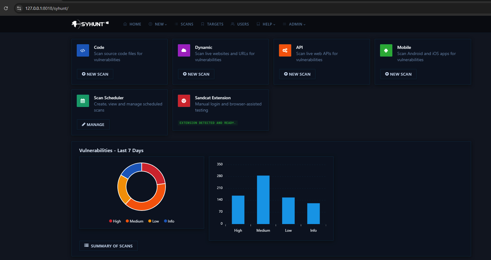
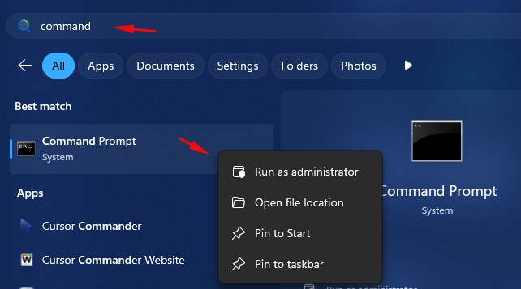
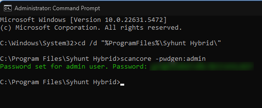
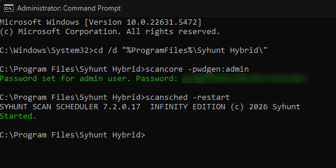
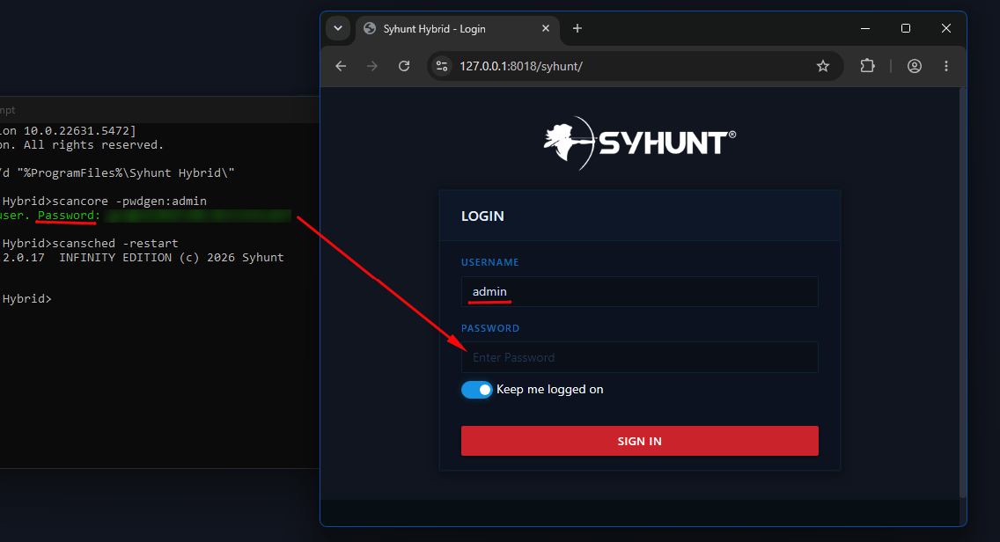

# Web UI

> **Applies to:** Syhunt Hybrid 7.2

**Contents**

- [Introduction](#intro)
- [Enabling the Web UI](#firststeps)
- [Creating additional user accounts](#addusers)
- [Changing the default UI language](#changelang)
- [Password policy](#passwords)
- [User roles](#roles)
- [Tips](#tips)

<a id="intro"></a>

## Introduction

Since version 7.1.6, Syhunt Hybrid includes a web user interface that can be enabled on Windows, Linux and macOS. From it you can launch DAST, SAST and MAST scans; view results of all scans, whether started from the UI, the CLI, the REST API or the scheduler; generate reports and exports; manage users, permissions and active sessions; run console commands; and more. The Web UI and reports are available in eight languages: English, German, Spanish, French, Italian, Japanese, Korean and Portuguese.

The Web UI runs on OpenResty (NGINX + Lua). It hashes passwords with bcrypt at a high cost factor, generates session IDs securely and protects the login against brute-force attacks.



<a id="firststeps"></a>

## Enabling the Web UI

1. Open a terminal or Command Prompt in the Syhunt CLI folder (the [default location depends on your OS](../integrations/command-line.md#intro)):
   - **Linux:** `cd ${HOME}/syhunt-hybrid/carbon/`
   - **macOS:** `cd "/Applications/Syhunt Hybrid/carbon"`
   - **Windows:** open the Start menu and type `command`. Right-click **Command Prompt** and choose **Run as administrator**,<br><br>then run `cd /d "%ProgramFiles%\Syhunt Hybrid\"`.
2. Set up the admin account. Run the following command, which generates and sets the admin password, and save the password it prints; you'll need it to log in:
   ```
   scancore -pwdgen:admin
   ```
   
3. Start the server:
   - **Linux or macOS:** run `syservicereg`, then `webui_utils --sslenable`. The Web UI service is installed and started.
   - **Windows:** restart Windows (the Web UI starts at boot), or, to avoid rebooting, run `scansched -restart` as an administrator.<br>
4. Open the Web UI:
   1. In your browser, go to `https://127.0.0.1:8018/syhunt/`.
   2. Enter the username `admin` and the generated password.<br>
   3. Click **Sign In**.

### Notes

- On **Windows**, once the admin password is set, the Web UI starts whenever the Hybrid Scheduler service starts, so it keeps running even when the current user logs out. On Linux, the Syhunt Web UI service does the same.
- On **AlmaLinux**, if the Web UI service fails to start, you may need to disable SELinux permanently. After rebooting, the service should run normally:
  ```bash
  sudo sed -i 's/^SELINUX=.*/SELINUX=disabled/' /etc/selinux/config && sudo reboot
  ```

<a id="addusers"></a>

## Creating additional user accounts

To create another account, run:

```
scancore -pwdgen:someusername
```

<a id="changelang"></a>

## Changing the default UI language

To change the Web UI's language, run the following command with one of the [available language codes](../integrations/command-line.md#replanguages):

```
scancore -langset:CODE
```

<a id="passwords"></a>

## Password policy

To strengthen security and support compliance, Syhunt 7.1 introduced a strict Web UI password policy:

| Requirement | Admin accounts | Other accounts |
|---|---|---|
| Minimum length | 26 characters | 16 characters |
| Password reuse | Can't reuse the last 24 passwords | Can't reuse the last 10 passwords |

Every password must also:

- **not** include the username or any part of the user's full name;
- contain at least one uppercase letter (A–Z), one lowercase letter (a–z), one digit (0–9) and one non-alphanumeric character (such as `@`, `#`, `$`, `%`);
- **not** contain three or more identical consecutive characters (such as `AAA`), or three consecutive ascending or descending characters (such as `123`, `321`, `ABC`, `CBA`).

These rules are checked whenever a password is set. After an upgrade, if an existing password breaks any of them, you'll be asked to reset it at your next login.

The easiest way to create a compliant password is `scancore -pwdgen:<username>`, which securely generates a password, sets it and prints it. To type a password yourself, use `-pwdset` instead.

<a id="roles"></a>

## User roles

When logged in as the administrator, you can assign any user the Operator, Restricted Operator or Viewer role:

| Role | Can do |
|---|---|
| **Administrator** | Launch scans and view all results, edit user permissions and preferences, and run console commands. Only one admin account is currently allowed. |
| **Operator** | Launch scans and view the results of all scans. |
| **Restricted Operator** | Launch scans, but view only the results of their own scans. |
| **Viewer** | View the results of all scans, but not launch scans. |

### Permissions by role

| Permission | Admin | Operator | Restricted Operator | Viewer |
|---|---|---|---|---|
| Administrative alerts on the Home screen | ✅ | | | |
| Delete scans, targets, users and connectors | ✅ | | | |
| **User access control** | | | | |
| Access the Users screen | ✅ | | | |
| Create users | ✅ | | | |
| Change a user's role | ✅ | | | |
| Access user profiles | ✅ | Own only | Own only | Own only |
| Invalidate user sessions | ✅ | Own only | Own only | Own only |
| Change a user's password | ✅ | Own only | Own only | Own only |
| **Scans and targets** | | | | |
| Launch scans | ✅ | ✅ | ✅ | |
| Access the Targets screen and preferences | ✅ | ✅ | ✅ | ✅ (read-only) |
| Access scan information (logs, comparison, findings, summary, map, reports, exports, debug, list) | ✅ | ✅ | Own scans only | ✅ |
| Access action information (including preview) | ✅ | ✅ | Own scans only | ✅ |
| **Administrative screens** | | | | |
| Access the scheduled scan list | ✅ | ✅ | ✅ | ✅ |
| Access individual scheduled scan details | ✅ | | | |
| Access the Connectors screen | ✅ | | | |
| Access the command console | ✅ | | | |
| Access the global preferences and lists (including export) | ✅ | | | |
| Access the scheduler log (if enabled) | ✅ | ✅ | | |
| **Import** | | | | |
| Import API specifications | ✅ | ✅ | | |
| Insert or update the product license | ✅ | | | |

<a id="tips"></a>

## Tips

### Scheduler time mismatch

If the time on the Scan Scheduler screen doesn't match your system's time, set the system time zone (replace `Europe/Lisbon` with yours):

- **macOS:** `sudo /usr/sbin/systemsetup -settimezone "Europe/Lisbon"`
- **Linux:** `sudo timedatectl set-timezone Europe/Lisbon`

### Scanning private repositories

Before scanning a private Git repository from the Web UI, configure the repository credentials or SSH keys and test the scan with the [`scancode` command](../integrations/command-line.md#cli_code_begin).

### Limitations

Direct connections to non-Git Azure DevOps (TFS) repositories are not supported on Linux or macOS.
