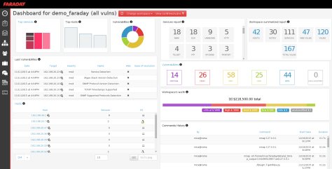

# Faraday

> **Applies to:** Syhunt Hybrid 7.2



[Faraday](https://faradaysec.com/) lets teams manage their attack surface from a single place while automating and speeding up key steps of vulnerability management. It brings an otherwise overwhelming number of security tools and procedures together into one simple process.

Syhunt can connect to a Faraday server's API and submit SAST or DAST results automatically. Faraday also ships with a Syhunt plugin, so Syhunt results can be uploaded through Faraday's web UI, CLI and REST API.

## Submitting results automatically

**1. Create a Faraday connector**

1. Click **Connectors** in the Web UI's top menu.<br>
2. Click **Add**. The **New Connector** screen opens.
3. Enter a name for the connector (for example, `MyFaraday`).
4. Set **Type** to **Faraday**.
5. Click **Create** and, after the success message, **Close**.

**2. Configure it**

1. Click the connector in the list. Its preferences screen opens.
2. Enter the Faraday server URL, for example `https://yourdashboard.apps.faradaysec.com/`.
3. Enter your workspace name. If you leave it empty, `my_workspace` is used.
4. Enter your username and password.
5. Click **Save**.

**3. Test it**

Click the connector in the list and choose **Run Test**. If everything is set up correctly, a test scan appears in your Faraday dashboard. Otherwise, an error message suggests what to fix.

**4. Attach it to your scans**

- **CLI:** pass `-tk:<connectorname>`.
- **Scheduled scans:** in the scheduled scan's preferences, on the **Notifications** tab, select the connector under **Issue Tracker #1** or **#2**.

### Creating the connector from the CLI

```lua
-- Add a Faraday tracker
scancore -tracker:add
-- Enter the type (Faraday) and a name for the tracker, then press Enter.

-- Configure it
scancore -tracker:set to:mytrackername -key:api.url -v:"https://yourdashboard.apps.faradaysec.com/"
scancore -tracker:set to:mytrackername -key:auth.username.encrypted -v:yourusername
scancore -tracker:set to:mytrackername -key:auth.password.encrypted -vsecret

-- Test it
scancore -tracker:send -tid:TEST -to:mytrackername
```
