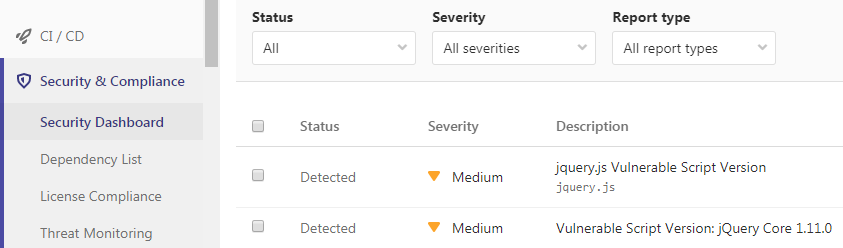
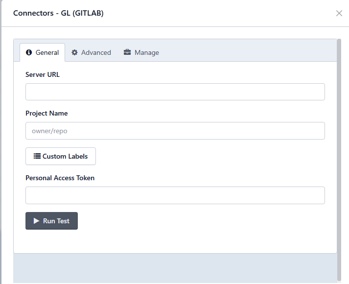

# GitLab

> **Applies to:** Syhunt Hybrid 7.2

**Contents**

- [Introduction](#intro)
- [Activating a Syhunt runner](#gitlabrunner)
- [Adding Syhunt to your CI file](#addyml)
- [GitLab security dashboard](#dashboard)
- [Scan functions and pass/fail conditions](#dast)
- [Advanced runner settings](#advancedsettings)
- [Sending vulnerabilities to GitLab Issues](#submitissues)

<a id="intro"></a>

## Introduction

You can launch Syhunt scans from a GitLab CI pipeline, bringing Syhunt Dynamic, Syhunt Code and Syhunt Mobile into your continuous delivery pipeline and security dashboard, scheduling scans and more. You can also set up GitLab as an issue tracker in Syhunt, so vulnerabilities can be submitted to a project's Issues.



The following job scans the repository's source code, fails if medium- or high-risk vulnerabilities are found, attaches a PDF report to the job's artifacts and adds the findings to GitLab's security dashboard:

```yaml
syhunt_test:
  script:
    - Start-CodeScan -pfcond 'medium' -output 'report.pdf' -outputex 'gl-sast-report.json'
  artifacts:
    reports:
      sast: gl-sast-report.json
    paths:
      - report.pdf
    when: on_failure
  tags:
    - syhunt
```

<a id="gitlabrunner"></a>

## Activating a Syhunt runner

The Syhunt runner is a CI service that receives scan requests, runs the scans and reports the results back to GitLab.

> [!IMPORTANT]
> For security and performance, install the runner on a separate virtual machine or a dedicated physical machine.

1. In your GitLab project, get a runner registration token:
   1. Click **Settings → CI/CD**.
   2. Expand **Runners**.
   3. Scroll to **Set up a specific Runner manually**.
   4. Copy the registration token and keep it somewhere safe; you'll need it shortly.
2. Install [Git for Windows](https://gitforwindows.org/) with the default settings.
3. Install Syhunt Hybrid (`syhunt-hybrid-<version>.exe`) with the default settings.
4. Download and run the Syhunt Runner setup. When prompted for the runner registration details, paste the registration token, click **Next** and complete the installation.

Go back to the **Runners** section in GitLab and refresh the page (F5). `syhuntrunner` should now appear under **Runners activated for this project**:


Syhunt can now be called from your CI pipeline.

<a id="addyml"></a>

## Adding Syhunt to your CI file

If your repository doesn't have a CI file yet, go to **Project overview** and click **Set up CI/CD**. This creates a `.gitlab-ci.yml` file in the repository.

**SAST example:** scans the repository's source code, fails if medium- or high-risk vulnerabilities are found, attaches a PDF report to the job's artifacts and adds the findings to the security dashboard:

```yaml
syhunt_test:
  stage: test
  script:
    - Start-CodeScan -pfcond 'medium' -output 'report.pdf' -outputex 'gl-sast-report.json'
  artifacts:
    reports:
      sast: gl-sast-report.json
    paths:
      - report.pdf
    when: on_failure
  tags:
    - syhunt
```

**DAST example:** scans the live web application after deployment, fails if medium- or high-risk vulnerabilities are found, attaches a PDF report to the job's artifacts and adds the findings to the security dashboard:

```yaml
production:
  stage: deploy
  script:
    - Start-DynamicScan -target 'www.productionurl.com' -pfcond 'medium' -output 'report.pdf' -outputex 'gl-dast-report.json'
  artifacts:
    reports:
      dast: gl-dast-report.json
    paths:
      - report.pdf
    when: on_failure
  tags:
    - syhunt
  only:
    - tags
```

For more examples, see the [PowerShell guide](powershell.md#examples).

<a id="dashboard"></a>

## GitLab security dashboard

Syhunt generates a GitLab-compatible vulnerability report when the `-outputex` file name is:

- **SAST:** `gl-sast-report.json` or `<anyname>.gls.json`
- **DAST:** `gl-dast-report.json` or `<anyname>.gld.json`

To enable the integration, also add the file to `artifacts.reports.sast` or `artifacts.reports.dast` in your CI file, as in the examples above.

**How GitLab displays the results**

- GitLab currently adds only **successful** pipelines to a project's security dashboard and vulnerability report. To see every finding there, omit `-pfcond` from the Syhunt step. Alternatively, with a `high` pass/fail condition, if no high-risk vulnerabilities are found, all medium- to info-level findings appear in the dashboard.
- The pipeline's **Security** tab always lists every vulnerability, whether the pipeline succeeded or failed. However, if the pipeline failed because a pass/fail condition was met, GitLab may inconsistently show a count of 0 vulnerabilities while still listing them. This is a [known GitLab issue](https://gitlab.com/gitlab-org/gitlab/-/issues/352157).

> [!TIP]
> If this is the first scan of a **large** codebase, scan it once without the dashboard integration to check how many vulnerabilities there are. If there are many, fix the first batch reported by Syhunt to improve the application's security, and only then enable the dashboard integration.

<a id="dast"></a>
<a id="sast"></a>
<a id="passfail"></a>

## Scan functions and pass/fail conditions

CI jobs call the Syhunt PowerShell functions. See the PowerShell guide for all parameters:

- [`Start-DynamicScan`](powershell.md#dynamicscan)
- [`Start-CodeScan`](powershell.md#codescan)
- [Pass/fail conditions](powershell.md#pfcond)


<a id="advancedsettings"></a>

## Advanced runner settings

To let the runner process several jobs at once, increase the `concurrent` value in `C:\SyhuntRunner\config.toml`. See GitLab's [advanced configuration](https://docs.gitlab.com/runner/configuration/advanced-configuration.html) documentation.

<a id="submitissues"></a>

## Sending vulnerabilities to GitLab Issues

Once a GitLab issue tracker is configured, you can submit a vulnerability to a project with one click.



See [Issue Trackers: GitLab](issue-trackers.md#tracker_gitlab) for how to set up the tracker, and [Submitting vulnerabilities to a tracker](issue-trackers.md#tracker_submit) for how to send findings.
