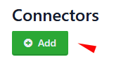

# Issue Trackers

> **Applies to:** Syhunt Hybrid 7.2

**Contents**

- [GitHub Issues](#tracker_github)
- [GitLab Issues](#tracker_gitlab)
- [Jira](#tracker_jira)
- [Submitting vulnerabilities to a tracker](#tracker_submit)
- [Short names for tracker preferences](#shortnames)

Once an issue tracker is configured in Syhunt, you can submit vulnerabilities to a project with one click. Trackers are created as *connectors* in the Web UI; you can also manage them from the [command line](command-line.md#cli_trackers).

<a id="tracker_github"></a>
<a id="tracker_githubbegin"></a>

## GitHub Issues

**1. Create a personal access token** with the `repo` scope, if you don't have one:

1. Log in to GitHub.
2. Click your avatar (top-right corner) and choose **Settings**.
3. In the left menu, scroll down and choose **Developer settings**.
4. Choose **Personal access tokens**, then **Generate new token**.
5. Optionally, enter a note for the token.
6. Select the `repo` scope.
7. Click **Generate token**.
8. Store the token somewhere safe. Once you leave or refresh the page, you won't be able to see it again.

**2. Add a GitHub tracker:**

1. Open **Connectors** in the Web UI.<br>
2. Click **Add**.<br>
3. Enter a name for the tracker (for example, `MyProjectName`).
4. Set the type to **GitHub**.
5. Click **Create**, then **Close**.
6. Click the new tracker in the list. Its preferences screen opens.
7. Enter the GitHub project in the format `owner/repo`.
8. Enter your personal access token and click **Save**.
9. Open the tracker again and click **Run Test**.<br>

If everything is set up correctly, a test issue is created at `https://github.com/<owner>/<repo>/issues`. Otherwise, an error message suggests what to fix.

<a id="tracker_gitlab"></a>
<a id="tracker_gitlabbegin"></a>

## GitLab Issues

> [!TIP]
> To integrate Syhunt with GitLab CI and the GitLab security dashboard, see [GitLab](gitlab.md).

**1. Create a personal access token** with the `api` scope, if you don't have one:

1. Log in to GitLab.
2. Click your avatar (top-right corner) and choose **Settings**.
3. In the User Settings menu, choose **Access Tokens**.
4. Enter a name and, optionally, an expiry date.
5. Select the `api` scope.
6. Click **Create personal access token**.
7. Store the token somewhere safe. Once you leave or refresh the page, you won't be able to see it again.

**2. Add a GitLab tracker:**

1. Open **Connectors** in the Web UI.<br>
2. Click **Add**.<br>
3. Enter a name for the tracker (for example, `MyProjectName`).
4. Set the type to **GitLab**.
5. Click **Create**, then **Close**.
6. Click the new tracker in the list. Its preferences screen opens.
7. Enter the GitLab project in the format `owner/repo`.
8. Enter the GitLab server URL, for example `https://gitlab.com/` or your own server's URL.
9. Enter your personal access token and click **Save**.
10. Open the tracker again and click **Run Test**.<br>

If everything is set up correctly, a test issue is created at `https://<gitlab_server>/<owner>/<repo>/issues`. Otherwise, an error message suggests what to fix.

<a id="tracker_gitlabend"></a>
<a id="tracker_jira"></a>

## Jira

1. Open **Connectors** in the Web UI.<br>
2. Click **Add**.<br>
3. Enter a name for the tracker (for example, `MyProjectName`).
4. Set the type to **JIRA**.
5. Click **Create**, then **Close**.
6. Click the new tracker in the list. Its preferences screen opens.
7. Enter a valid Jira project name.
8. Enter the Jira server URL, for example `http://<IP>:8080/`.
9. If you don't want the default issue type, enter a valid issue type name.
10. Enter your Jira credentials (username and password) and click **Save**.
11. Open the tracker again and click **Run Test**.<br>

If everything is set up correctly, a test issue is created in your Jira project. Otherwise, an error message suggests what to fix.

<a id="tracker_submit"></a>

## Submitting vulnerabilities to a tracker

1. Open the **Vulnerabilities** tab of a running scan, or open **Scans**, click a scan in the list and go to its **Vulnerabilities** tab.
2. Select one or more vulnerabilities, click **Send To** and choose the tracker.

   

Syhunt can also send a summary of the vulnerabilities found to a tracker automatically:

- from a **scheduled scan**, if configured on its schedule screen;
- from the **CLI**, with the `-tk` parameter of `scanurl` or `scancode` (see [Command Line](command-line.md#cli_trackers_send));
- from **PowerShell** or a **CI workflow**, with the `-tracker` parameter:

```powershell
# PowerShell, existing tracker
Start-CodeScan -pfcond "medium" -tracker "YOURTRACKERNAME"

# PowerShell, tracker defined on the fly
Start-CodeScan -pfcond "medium" -tracker "?app=github###project=user/project###token=YOURTOKEN"

# GitHub Actions workflow, tracker defined on the fly
Start-CodeScan -pfcond "medium" -tracker "?app=github###project=${{ github.repository }}###token=${{ secrets.GITHUB_TOKEN }}"
```

<a id="shortnames"></a>

## Short names for tracker preferences

When you pass [tracker preferences](../reference/preferences.md#prefs_tracker) through `-tk` or `-tracker`, use the short names below. Settings without a short name can't be set through these parameters.

| Short name | Preference ID | Type |
|---|---|---|
| `app` | `tracker.defaultapp` | string |
| `project` | `tracker.project.name` | string |
| `token` | `tracker.auth.token.encrypted` | string |
| `from` | `tracker.message.from` | string |
| `to` | `tracker.message.tolist` | string |
| `subject` | `tracker.message.subject` | string |
| `notifyonfailonly` | `tracker.notifyonfailonly` | boolean |
| `apiurl` | `tracker.api.url` | string |

**DefectDojo-specific:**

| Short name | Preference ID | Type |
|---|---|---|
| `producttypename` | `tracker.scan.producttypename` | string |
| `testtitle` | `tracker.scan.testtitle` | string |
| `engagementname` | `tracker.scan.engagementname` | string |
| `productname` | `tracker.scan.productname` | string |
| `minseverity` | `tracker.scan.minseverity` | string |
| `pushtojira` | `tracker.scan.pushtojira` | boolean |
| `verified` | `tracker.scan.verified` | boolean |
| `closeoldfindings` | `tracker.scan.closeoldfindings` | boolean |
| `skipduplicates` | `tracker.scan.skipduplicates` | boolean |
| `active` | `tracker.scan.active` | boolean |
| `autocreatecontext` | `tracker.scan.autocreatecontext` | boolean |
