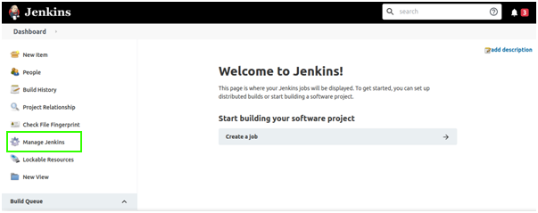
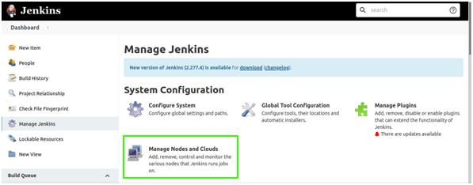
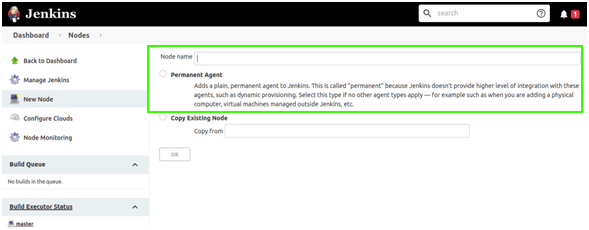
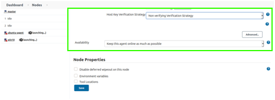

# Jenkins

> **Applies to:** Syhunt Hybrid 7.2

**Contents**

- [Introduction](#intro)
- [Activating a Syhunt agent](#agents)
- [Before installing Syhunt (Windows)](#preinstall_win)
- [Before installing Syhunt (Linux)](#preinstall_linux)
- [Adding Syhunt to a pipeline](#pipeline_integration)
- [`scanURL` function](#scanurl)
- [`scanCode` function](#scancode)
- [Pass/fail conditions](#pfcond)
- [Scheduling scans](#sched)

<a id="intro"></a>

## Introduction

You can run Syhunt scans from a Jenkins pipeline script, bringing Syhunt Dynamic, Syhunt Code and Syhunt Mobile into your continuous delivery pipeline, scheduling scans and more.

### Where to install Syhunt

Syhunt can be installed on either:

1. **The Jenkins machine itself**, so that Syhunt and the Jenkins server run side by side; or
2. **A separate machine acting as a Jenkins agent**, which the main Jenkins server calls remotely over SSH.

Using CI agents is common best practice in DevOps environments, so we strongly recommend the second option. For security and performance, production environments should also use a dedicated machine as the agent.

On Windows or Linux, **install Syhunt after Jenkins is deployed and set up**. The Syhunt installer then detects Jenkins and installs the required extensions automatically. If you installed Syhunt first, just run the Syhunt installer again.

Remember that Syhunt is licensed per device: each agent machine needs its own license.

<a id="agents"></a>

## Activating a Syhunt agent

Once both the main (controller) and agent Jenkins installations are deployed and set up, make the agent available to the controller:

1. On the controller's Jenkins dashboard, click **Manage Jenkins** in the sidebar.<br>
2. Under **System Configuration**, click **Manage Nodes and Clouds**.<br>
3. On the **Nodes** screen, click **New Node** in the sidebar.<br>
   1. Name the node.<br>
   2. Select **Permanent Agent** and click **OK**.
   3. Set **# of executors** to **2**.<br>
   4. Set **Remote root directory** to the Jenkins directory on the agent: `/var/lib/jenkins` on Linux. On Windows, use the `.jenkins` directory, usually `C:\Users\<youruser>\.jenkins` or `C:\windows\system32\config\systemprofile\AppData\Local\Jenkins\.jenkins`; check which one exists on the agent.
   5. Give the node a label you'll use to refer to it later, for example `Syhunt`.
   6. Leave **Usage** at its default.<br>
   7. Set **Launch method** to **Launch agents via SSH**.
   8. Enter the agent machine's host name or IP address.
   9. Under **Credentials**, click **Add** and enter the username and password of the agent's Jenkins user.
   10. Set the **Host Key Verification Strategy**:
       - If you don't have an SSH credential, use **Non verifying Verification Strategy**.<br>
       - If you created a Jenkins SSH credential on the agent, as described in the [Jenkins documentation](https://www.jenkins.io/doc/book/using/using-agents/), use **Manually provided key Verification Strategy**. Using a verification strategy is recommended for better security, especially in production.
   11. Leave **Availability** at its default.
   12. Click **Save**.
4. If you haven't already, install Syhunt on the agent machine as described below.

<a id="preinstall_win"></a>

## Before installing Syhunt (Windows)

After deploying and setting up Jenkins:

1. If you'll use `scanCode()` to scan Git URLs, install [Git for Windows](https://gitforwindows.org/).
2. Install Syhunt as described in the [installation guide](../installation/install-windows.md).

<a id="preinstall_linux"></a>

## Before installing Syhunt (Linux)

After deploying and setting up Jenkins, change the Jenkins user to your current user (as long as it isn't `root`) or another user of your choice. We advise against running Jenkins as `root`, which could expose the operating system and the Jenkins repositories.

1. Edit the Jenkins configuration file:
   - CentOS: `sudo vi /etc/sysconfig/jenkins`
   - Ubuntu: `sudo vi /etc/default/jenkins`
2. Change `JENKINS_USER="jenkins"` to `JENKINS_USER="userofyourchoice"`.
3. Give the new user ownership of the main Jenkins directories:
   ```bash
   sudo chown -R userofyourchoice:userofyourchoice /var/lib/jenkins
   sudo chown -R userofyourchoice:userofyourchoice /var/log/jenkins
   sudo chown -R userofyourchoice:userofyourchoice /var/cache/jenkins
   ```
4. Restart Jenkins:
   ```bash
   sudo systemctl restart jenkins
   ```
5. Logged in as that user, install Syhunt as described in the [Linux installation guide](../installation/install-linux.md). If you'll use `scanCode()` to scan Git URLs, install Git as well (also covered there).

<a id="pipeline_integration"></a>

## Adding Syhunt to a pipeline

1. On the Jenkins dashboard, open the pipeline.
2. Click **Configure** in the sidebar.
3. On the **Pipeline** tab, clear **Use Groovy Sandbox** if it's selected.
4. Add code like this at the appropriate point of your pipeline script:

   ```groovy
   def rootDir = pwd()
   def syhunt = load "${rootDir}/../workspace@script/syhunt/syhunt.groovy"
   syhunt.scanURL([target: 'http://somewebsite.com/', huntMethod: 'appscan', pfcond: 'fail-if:risk=mediumup'])
   ```

   A complete example:

   ```groovy
   #!/usr/bin/env groovy

   // If you're not using an agent, change the next line to just: node {
   node ("Syhunt") {
       stage('Scan') {
           def rootDir = pwd()
           def syhunt = load "${rootDir}/../workspace@script/syhunt/syhunt.groovy"
           syhunt.scanURL([target: 'http://somewebsite.com/', huntMethod: 'appscan', pfcond: 'fail-if:risk=mediumup'])
       }
   }
   ```
5. Click **Save**.

### Running the build

When the pipeline runs, its console output will look something like this:

```
[Pipeline] echo
Preparing to scan URL: http://somewebsite.com/
[Pipeline] echo
VULNERABLE!
Found 2 vulnerabilities
SYHUNT URLSCAN 6.8.5.4 PLATINUM EDITION (c) 2020 Syhunt
...
[Pipeline] echo
Build problem: found Medium risk vulnerabilities.
[Pipeline] }
[Pipeline] // stage
[Pipeline] }
[Pipeline] // node
[Pipeline] End of Pipeline
Finished: FAILURE
```

<a id="scanurl"></a>

## `scanURL` function

Launches a Syhunt Dynamic scan.

| Parameter | Description |
|---|---|
| `target` **(required)** | The URL to scan, for example `http://www.somesite.com`. |
| `huntMethod` | The [hunt method](../scanning/hunt-methods.md) to use. If omitted, the default method is used. |
| `pfcond` | Fails the build when a [pass/fail condition](#pfcond) is met. |
| `timelimit` | Maximum scan time, for example `1d`, `3h`, `2h30m`, `50m`. The scan is aborted when it's reached. No limit by default. |

Returns a map with:

| Key | Description |
|---|---|
| `outFilename` | The generated report's file name. |
| `outResultHTML` | The generated report's contents, as HTML text. |

<a id="scancode"></a>

## `scanCode` function

Launches a Syhunt Code scan.

| Parameter | Description |
|---|---|
| `target` **(required)** | A repository URL, or a local source code folder or file. |
| `huntMethod` | The [hunt method](../scanning/hunt-methods.md) to use. If omitted, the default method is used. |
| `pfcond` | Fails the build when a [pass/fail condition](#pfcond) is met. |
| `branch` | The Git branch to scan. If omitted, the Git client fetches the default branch. Not needed for local folders or files. |
| `timelimit` | Maximum scan time, for example `1d`, `3h`, `2h30m`, `50m`. No limit by default. |

Returns the same map as `scanURL()`.

```groovy
syhunt.scanCode([target: 'https://github.com/someuser/somerepo.git', huntMethod: 'normal', pfcond: 'fail-if:risk=mediumup'])
syhunt.scanCode([target: 'C:\\www\\', huntMethod: 'normal', pfcond: 'fail-if:risk=mediumup'])
```

<a id="pfcond"></a>

## Pass/fail conditions

| Condition | Fails if… |
|---|---|
| `high` or `fail-if:risk=high` | a High-risk vulnerability or threat is found. |
| `medium` or `fail-if:risk=mediumup` | a Medium- or High-risk vulnerability or threat is found. |
| `low` or `fail-if:risk=lowup` | a Low-, Medium- or High-risk vulnerability or threat is found. |

<a id="sched"></a>
<a id="sched_begin"></a>

## Scheduling scans

1. On the Jenkins dashboard, open the pipeline.
2. Click **Configure** in the sidebar.
3. On the **Build Triggers** tab, select **Build periodically** and enter the schedule.
4. Click **Save**.

<a id="sched_end"></a>
