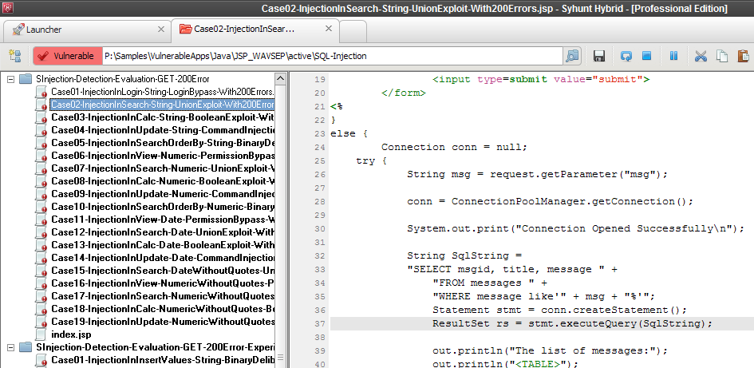
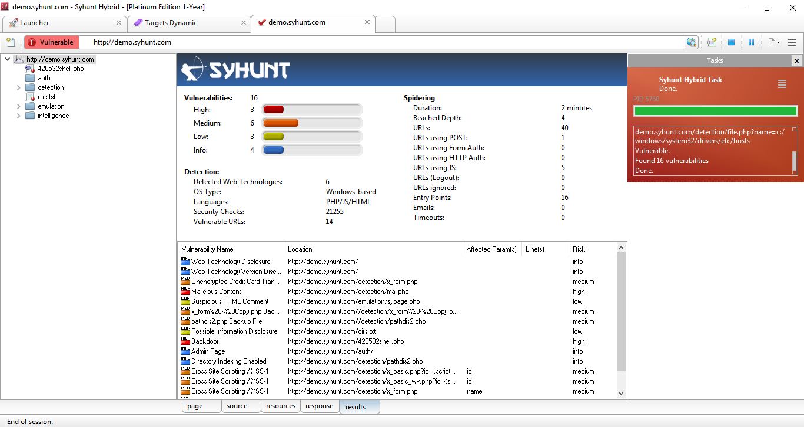
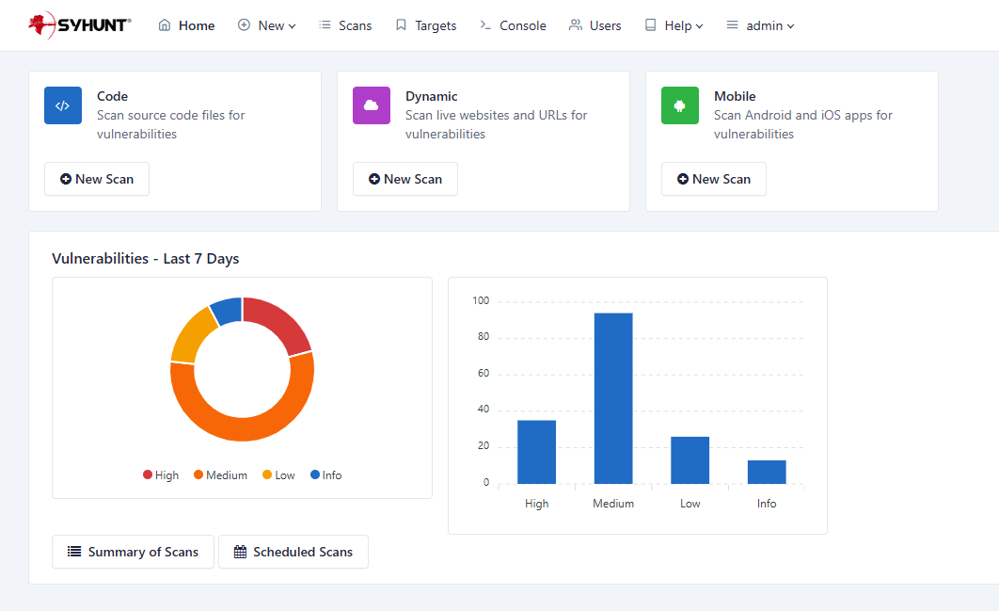

# Technical Specifications

> **Applies to:** Syhunt Hybrid 7.2

**Contents**

- [A. License rights](#License)
- [B. Architecture and vulnerability database](#Architecture)
- [C. Source code analysis (SAST)](#SAST)
- [C2. Mobile and APK analysis (MAST)](#MAST)
- [D. Dynamic analysis (DAST)](#DAST)
- [D2. Augmented analysis (OAST)](#OAST)
- [D3. Hybrid-augmented analysis (HAST)](#HAST)
- [D4. API analysis (AAST)](#AAST)
- [D5. Forensic log analysis (FAST)](#FAST)
- [E. Management console](#Console)
- [F. Scan features](#Features)
- [G. System requirements](#Specs)
- [H. Glossary](#Glossary)

This document describes the technical specifications of **Syhunt Hybrid**, a highly accurate application security testing tool with deep coverage. It combines augmented HAST (hybrid application security testing), DAST (dynamic), SAST (static) and MAST (mobile) to identify vulnerabilities and weaknesses in applications.

<a id="License"></a>

## A. License rights

- Syhunt Hybrid licenses are usually valid for **12 months**.
- Licenses include version updates and technical support, as well as technical documentation in English.
- Licenses allow an unlimited number of scans against an unlimited number of assets per year, launched from a single device (or more, if additional seats are ordered). Each license includes two Web UI users, an administrator and one other user; more can be purchased.
- Some licenses cover every supported programming language; others cover at least one. More languages can be purchased as needed.
- Licenses allow integration with AI through a configurable API endpoint. Syhunt currently supports OpenAI, DeepSeek and local models. Costs and hardware needed to run a local or cloud model are not covered by Syhunt licenses.

<a id="Architecture"></a>

## B. Architecture

Syhunt Hybrid is an application security assessment tool that is:

- **Hybrid:** it combines several analysis techniques (DAST, OAST, SAST, MAST and FAST, described below).
- **On-premises:** it is deployed on the customer's premises, so analyzed source code and results never leave the internal network.
- **Modular:** a single management console brings together the configuration and results of every module.
- **Asynchronous:** it runs several scans at the same time, without waiting for each one to finish.
- **Multi-process:** each scan runs as a separate operating system process.
- **Accessible from the web and the command line:** it has a responsive web interface and a CLI for launching dynamic and code scans and other tasks.

<a id="typoftest"></a>

### Types of testing

| Type | Description |
|---|---|
| **[SAST](#SAST)** | Static analysis of web application source code. |
| **[MAST](#MAST)** | Static analysis of mobile application source code (Android and iOS) and Android APK files. |
| **[DAST](#DAST)** | Dynamic analysis of web applications, with deep crawling and parameter injection. |
| **[OAST](#OAST)** | Augmented dynamic analysis of web applications using out-of-band (OOB) techniques. |
| **[HAST](#HAST)** | Hybrid-augmented analysis: static analysis results are automatically used to enhance augmented dynamic analysis. |
| **[AAST](#AAST)** | Dynamic analysis of web APIs, driven by an API specification. |
| **[FAST](#FAST)** | Forensic analysis of web server log files. |

<a id="typoftestend"></a>
<a id="vdb"></a>

### Vulnerability database

Syhunt includes an internal vulnerability database covering the public vulnerability lists and standards below. It is updated regularly, so the tool keeps up with new vulnerabilities published by international databases.

| Standard | Coverage |
|---|---|
| **CWE/SANS Top 25** | Most Dangerous Software Errors, 2023 or later |
| **OWASP Top 10** | Web Application Security Risks, 2021 or later |
| **OWASP Mobile Top 10** | Mobile Risks, 2024 or later (PLUS) |
| **OWASP PHP Top 5** | |
| **CWE** | Common Weakness Enumeration |
| **CVE** | Common Vulnerabilities and Exposures |
| **ISO/IEC 27001** | |
| **WASC** | Web Application Security Consortium Threat Classification |
| **WAVSEP** | Web Application Vulnerability Scanner Evaluation Project |
| **NIST SAMATE** | Software Assurance Metrics and Tool Evaluation project |
| **PCI DSS** | Payment Card Industry Data Security Standard, 3.2, 3.2.1 or later |

<a id="integrations"></a>

### Integrations

| Category | Systems |
|---|---|
| **Issue tracking** | Jira 7.13.0 or later<br>GitHub<br>GitLab |
| **Version control** | Public and private Git repositories<br>Azure DevOps and TFS repositories (TFVC and Git)<br>GitHub and GitLab<br>Branches |
| **APIs and scripting** | Lua 5.1 API<br>Web API (REST)<br>PowerShell<br>JSON and XML<br>Selenium |
| **Security dashboards** | OWASP DefectDojo<br>GitLab Security Dashboard<br>Faraday |
| **Application vulnerability management (WAF)** | F5 BIG-IP Application Security Manager (ASM)<br>Imperva SecureSphere<br>ModSecurity CRS<br>OGASEC WAF |
| **CI/CD** | GitHub Actions<br>GitLab CI and Security Dashboard<br>Bitbucket Pipelines<br>Jenkins Pipeline |
| **Browsers** | Syhunt Sandcat extension (Chromium-based browsers)<br>Google Chrome<br>Mozilla Firefox |
| **Email** | SMTP |

The examples below show how to scan a Git repository through each integration:

```lua
-- Command prompt
scancode git://sub.domain.com/repo.git
scancode https://github.com/user/repo.git -rb:master
scancode https://dev.azure.com/user/projectname

-- GitLab CI script
- Start-CodeScan -pfcond 'fail-if:risk=mediumup' -output 'report.pdf' -outputex 'gl-sast-report.json'

-- GitHub Actions script
- Start-CodeScan -pfcond 'fail-if:risk=mediumup' -output 'report.pdf'

-- Jenkins pipeline script
syhunt.scanCode([target: 'https://github.com/someuser/somerepo.git', branch: 'master', pfcond: 'fail-if:risk=mediumup'])

-- PowerShell
$MyScan = @{
  target = 'https://github.com/someuser/somerepo.git';
  branch = 'master';
  pfcond = 'fail-if:risk=mediumup';
  output = 'report.pdf'
}
Start-CodeScan @MyScan

-- Lua script
code:scanurl('https://github.com/someuser/somerepo.git', 'master')

-- Web API (REST, raw JSON), POST /syhunt/launch.lua
{
  "sourcetarget": "https://github.com/someuser/somerepo.git",
  "sourcebranch": "master",
  "apikey": "YOUR_API_KEY"
}
```

<a id="Languages"></a>

### Supported languages and environments

| Language | Environments and frameworks |
|---|---|
| **C#** | ASP.NET Web Forms (ASPX)<br>ASP.NET Core MVC<br>.NET MAUI (iOS and Android)<br>Xamarin (iOS and Android)<br>Blazor<br>Razor Pages |
| **Dart** | Flutter (iOS and Android)<br>Server side |
| **Java** | JEE<br>JSP<br>Android<br>Spring Framework |
| **JavaScript** | Client side<br>Server side<br>Node.js (plain, Express.js and Koa.js)<br>Angular (2 or later)<br>AngularJS<br>JScript (Classic ASP)<br>Electron (desktop) |
| **Kotlin** | Ktor |
| **Lua** | ngx_lua<br>mod_lua<br>CGILua<br>Lua Pages |
| **Objective-C, C and C++** | iOS |
| **Object Pascal** | Delphi<br>Delphi XE<br>Lazarus<br>DWS |
| **Perl** | |
| **PHP** | |
| **Python** | CGI<br>mod_python<br>PSP<br>WSGI<br>Django |
| **Ruby** | Rails<br>ERB<br>mod_ruby |
| **Swift** | iOS |
| **TypeScript** | |
| **VB** | VB.NET (ASP.NET)<br>VBScript (Classic ASP) |

<a id="SAST"></a>

## C. Source code analysis (SAST)

| | |
|---|---|
| **Modules** | Syhunt Code; Syhunt Mobile |
| **Description** | Analyzes the source code of web and mobile applications for security vulnerabilities. |
| **Types of analysis** | SAST (Static Application Security Testing)<br>MAST (Mobile Application Security Testing) |
| **Target applications** | Web applications (including web services)<br>Mobile applications (Android and iOS)<br>Desktop applications |
| **Target languages and platforms** | APK (Android)<br>ASP.NET and Classic ASP<br>.NET MAUI / Xamarin (iOS and Android)<br>Blazor / Razor Pages<br>Dart (Android and iOS)<br>HTML<br>Java (including Android)<br>JavaScript<br>Kotlin (including Android)<br>Lua<br>Objective-C, C and C++ (iOS)<br>Object Pascal (Delphi)<br>Perl<br>PHP<br>Python<br>Ruby<br>Swift (iOS)<br>TypeScript |
| **Git integration** | Yes |

Capabilities:

- Detects known application vulnerabilities in every supported language and environment.
- Supports code embedded in HTML, print shorthands and string interpolation.
- Finds both client-side and server-side vulnerabilities.
- Detects outdated, vulnerable scripts, local or remote, such as vulnerable versions of AngularJS, jQuery, fullPage, Bootstrap and Moment.js.
- Analyzes complete codebases, code snippets and configuration files.
- Performs incremental analysis: key results and data from scans of a codebase are stored automatically and used to speed up later scans.
- Audits several programming languages in the same scan.
- Supports TypeScript, detecting vulnerabilities before the code is compiled to JavaScript (client and server side, Node.js and Angular).
- Identifies key areas of code, such as specific HTML markers, JavaScript, XHR requests, entry points and interesting keywords, and lets you navigate between them.
- Finds vulnerabilities caused by poorly designed code, that is, programming errors that expose the system to attack.
- Detects **shadow AI**, including use of DeepSeek, OpenAI, OpenAI-compatible and other emerging AI API endpoints.
- Analyzes configuration files to assess threats and identify countermeasures at the server, environment or application configuration level.
- Recognizes input filtering and validation, for accurate results free of false positives.
- *AI-powered:* adds fixed-code examples to reports, next to each vulnerable piece of code.
- *AI-powered:* adds a confidence score to each finding in reports, the estimated likelihood (as a percentage) that it is a true positive rather than a false positive.

### Real-time scan view


The interface shows the status of running code scans in real time, including:

- the tree of analyzed and vulnerable files;
- scan duration;
- number of scripts analyzed and vulnerable;
- number of vulnerabilities found, in total and by severity;
- number of lines analyzed;
- the list of vulnerabilities found.



It also highlights the points in the code where a single fix would remediate several of the vulnerabilities found.

<a id="MAST"></a>

## C2. Mobile and APK analysis (MAST)

Syhunt Code performs mobile application security testing on Android and iOS source code and on Android APK files, covering the main OWASP Mobile Top 10 and CWE/SANS Top 25 risks, such as:

1. Improper credential usage
2. Inadequate supply chain security
3. Insecure authentication/authorization
4. Insufficient input/output validation
5. Insecure communication
6. Inadequate privacy controls
7. Insufficient binary protections
8. Security misconfiguration
9. Insecure data storage
10. Insufficient cryptography

<a id="DAST"></a>

## D. Dynamic analysis (DAST)

| | |
|---|---|
| **Module** | Syhunt Dynamic Augmented |
| **Description** | Detects security vulnerabilities in dynamic web applications and web servers. |
| **Types of analysis** | DAST (Dynamic Application Security Testing)<br>OAST (Out-of-Band Application Security Testing) |
| **Target applications** | Web applications and web servers |
| **Target languages and platforms** | ASP.NET and Classic ASP<br>HTML and JavaScript<br>Java<br>Lua<br>Perl<br>PHP<br>Python<br>Ruby |
| **Optimized for HTTP servers** | Apache<br>Apache Tomcat<br>Microsoft IIS<br>NGINX<br>OpenResty |
| **Protocols** | HTTP 1.0 and 1.1<br>HTTPS (SSL 2, SSL 3, TLS 1 to TLS 1.3)<br>IPv6<br>Proxies (HTTP, SOCKS 4 and SOCKS 5) |
| **HTTP features** | Keep-Alive<br>GZIP compression<br>Authentication: Basic, Bearer, Digest (MD5/SHA-256/SHA-512), form-based and NTLM\* |

\* NTLM is available on Windows only. Kerberos support is planned.

Capabilities:

- Detects known web application vulnerabilities in every supported language and environment.
- Performs **augmented dynamic analysis**, combining DAST and OAST.
- Performs **hybrid-augmented analysis**, combining DAST, OAST and SAST.
- Performs incremental analysis: key results and data from scans of a target URL are stored automatically and used to speed up later scans.
- Supports a wide range of [authentication methods](../scanning/authenticated-scanning.md#methods), including automatic login-form detection (Smart and Standard), recorded browser logins (Recorder), Selenium-based logins (Selenium-Auto and Node.js scripts), HTTP authentication and manual login through the Sandcat extension.
- Reports whether an authenticated session was maintained from the start to the end of an authenticated scan.
- Detects outdated, vulnerable scripts, server software and other components.
- Finds both client-side and server-side vulnerabilities.
- Finds in-band, inferential and out-of-band (OOB) vulnerabilities.
- Detects known vulnerable applications in every supported language, including ColdFusion, Flash and Server-Side Includes (SSI).
- Detects **shadow AI** through injection techniques, including use of DeepSeek, OpenAI and other emerging AI systems.
- Automatically performs structure, login-form and HTTP authentication brute-force attacks.
- Automatically detects logout pages and avoids them during the scan, with an optional manual configuration.
- Supports both invasive and non-invasive scanning.
- Lets you turn off denial-of-service (DoS) tests that could affect the application's availability.
- Lets you configure the number of retries and the timeout for connecting to the application.
- Supports applications built on content management systems such as Drupal, Joomla, Wix and WordPress.
- Supports single-page applications (SPAs).
- Identifies the technologies used by the application and optimizes scan time accordingly.
- Identifies hidden versions of server software and components (Hunter-Sense™), such as Apache, NGINX, PHP, mod_ssl, OpenSSL and Phusion Passenger.
- Injects data and manipulates parameters in URLs and forms (GET and POST).
- Applies injection mutations to cover every supported language and platform.
- Performs time-based injection checks with a 0% false-positive rate for code injection, expression language injection, NoSQL injection, remote command execution and SQL injection.
- Finds vulnerabilities such as SQL injection, NoSQL injection, OS command injection, disclosure and code injection using inferential (response time), in-band (error message or print), out-of-band (OOB) and passive techniques.
- Includes an optional AJAX crawler for deep crawling of AJAX-heavy applications built with popular frameworks such as Angular, AngularJS and React, with pre-rendering and local storage support.

### Browsing and crawling

Syhunt maps the target application's structure, including every link and entry point, while emulating a modern browser with support for:

| Area | Support |
|---|---|
| **Web standards** | HTML5<br>CSS3 |
| **HTML analysis** | Relative paths<br>Standard HTML<br>Non-standard or malformed HTML<br>Form recognition |
| **Browser emulation** | Google Chrome<br>Mozilla Firefox<br>Microsoft Edge<br>Referer submission<br>Pre-rendering<br>Local storage |
| **JavaScript** | JavaScript analysis and execution<br>DOM emulation<br>Browser behavior<br>XHR (XMLHttpRequest) / AJAX calls<br>External JavaScript files |
| **User interaction simulation** | Key presses<br>Mouse clicks<br>Form autofill<br>Automatic login<br>Accidental logout prevention |
| **Cookies** | Cookie management<br>Session management |
| **Redirects** | HTTP<br>Meta refresh<br>JavaScript |
| **Process isolation** | Each scan runs as a separate process |
| **robots.txt** | Analyzed when available |

Syhunt handles large, complex websites with dynamically generated content and prevents loops while mapping the application. You can also limit scan depth, including:

- the maximum number of links per server and per page;
- the maximum URL size (bytes) and HTTP response size (kilobytes).

### Site preferences


Syhunt Dynamic lets you create scan profiles for assets, specifying:

- the technologies used by the application (server-side language, web server, operating system and database), to optimize scan time;
- start URLs;
- SSL certificates and authentication credentials, to scan while logged in to the target;
- objects to exclude from the scan, such as specific paths, forms and vulnerabilities;
- depth and layer limits;
- signatures for detecting custom 404 error pages;
- manually configured cookies and session tokens.

### Real-time scan view



The interface shows the status of running dynamic scans in real time, including:

- the site tree of found and vulnerable paths (site map and structure);
- scan duration;
- number of vulnerable URLs;
- number of URLs using POST, authentication and JavaScript;
- number of entry points;
- number of timeouts;
- number of vulnerabilities found, in total and by severity;
- number of security checks performed;
- detected web technologies;
- the target's operating system type;
- the target's programming languages;
- the depth reached;
- the list of vulnerabilities found.

### Manual and browser-assisted testing


Syhunt Dynamic supports manual and browser-assisted testing. Since version 7.2 this is done through the [Syhunt Sandcat browser extension](../installation/install-windows.md#sandcat); versions 7.1 and earlier included the built-in Sandcat Browser. Capabilities include:

- manual login to web applications;
- scanning after logging in with CAPTCHAs, tokens and other two-factor authentication mechanisms;
- scanning after manual crawling/navigation;
- capturing URLs and entry points.

The classic Sandcat Browser (7.1 and earlier) also offered live HTTP headers; previews of common web file formats (CSS, Flash, HTML, BMP, GIF, ICO, JPG, PNG, SVG, JavaScript, JSON, text and XML); automatic JavaScript deobfuscation; request replay; a fuzzer; a script executor; and HTTP/XHR editors with a request loader.

<a id="OAST"></a>

## D2. Augmented analysis (OAST)

| | |
|---|---|
| **Module** | Syhunt Signal |
| **Description** | Detects out-of-band security vulnerabilities in dynamic web applications. |
| **Type of analysis** | OAST (Out-of-Band Application Security Testing) |
| **Target applications** | Web applications |

Syhunt Dynamic Augmented works with the online **Syhunt Signal** service to perform automated out-of-band testing. Syhunt Signal:

- lets the scanner detect high-risk out-of-band (OOB) vulnerability variants that would otherwise be invisible;
- listens for requests forced from a vulnerable target server during the scan and signals them back to the scanner;
- automatically correlates the alerts it receives with the attack requests that triggered them;
- adds the OOB vulnerabilities found to the report and the user interface;
- returns zero false positives;
- automatically exfiltrates data from a vulnerable target, using environment- and OS-specific commands and techniques, and adds it to the scan results;
- requires an active Internet connection.

Out-of-band vulnerability types detected by Syhunt Signal:

- Command execution
- Remote file inclusion (RFI)
- Server-side request forgery (SSRF)
- SQL injection
- XML external entity (XXE) injection

<a id="HAST"></a>

## D3. Hybrid-augmented analysis (HAST)

Syhunt Hybrid combines the results of Syhunt Dynamic, Syhunt Signal and Syhunt Code to perform **hybrid-augmented analysis** (augmented HAST), in which static analysis results are automatically used to enhance augmented dynamic analysis. It:

- combines SAST, DAST and OAST;
- performs hybrid analysis of client-side JavaScript code (SAST-in-DAST);
- detects and confirms vulnerabilities dynamically by simulating inferential, in-band and out-of-band attacks, using entry points and other information obtained from the source code.

<a id="AAST"></a>

## D4. API analysis (AAST)

| | |
|---|---|
| **Module** | Syhunt API |
| **Description** | Detects security vulnerabilities in web APIs. |
| **Types of analysis** | AAST (API Application Security Testing)<br>OAST (Out-of-Band Application Security Testing) |
| **Target applications** | Web APIs |
| **Specification formats** | API Blueprint, OpenAPI 2 and 3, Swagger 1 to 3, Postman Collection 1 to 2.1, GraphQL (with REST annotations), I/O Docs, Google Discovery, RAML, WADL |

An API scan starts from an API specification instead of a start URL. Syhunt maps the API from the specification, validates that the API behaves as specified, and then tests its endpoints with the same injection techniques used in dynamic scans, covering both the OWASP Top 10 and the OWASP API Security Top 10. See [Web API Scanning](../scanning/api-scanning.md).

<a id="FAST"></a>

## D5. Forensic log analysis (FAST)

| | |
|---|---|
| **Module** | Syhunt Forensic |
| **Description** | Detects attacks against dynamic web applications. |
| **Type of analysis** | FAST (Forensic Application Security Testing) |
| **Target applications** | Web applications |

Syhunt Forensic performs on-demand heuristic security analysis of web server logs to detect attacks, including:

- identifying the origin (IP address), country, type and methods of attempts to compromise web applications;
- reconstructing attack sessions, accurately separating legitimate from malicious traffic, and automated from manual attacks;
- detecting intrusions, backdoor installation and the intrusion tools used;
- detecting attempts to exploit OWASP Top 10 vulnerabilities and the use of defense evasion techniques;
- supporting logs from Apache, Microsoft IIS and NGINX, with automatic format detection.

See [Forensic Log Analysis](../scanning/forensic-log-analysis.md).

<a id="Console"></a>

## E. Management console



The management console brings together module settings and the results of SAST, DAST and FAST scans. It:

- gives access to stored results of finished and running scans;
- can be used without prior knowledge of information security or secure coding;
- needs little or no user intervention before and during scans;
- shows the progress and risk level of each running analysis graphically;
- shows license information: license type, expiration date and supported programming languages;
- lets you disable vulnerability detection rules and see which rules are disabled;
- lets you ignore one or more specific vulnerabilities;
- lets you pause, resume and cancel scans immediately;
- lets you find, delete, export and import scan results;
- lets you add and manage assets;
- lets you export and import target lists as CSV or list files;
- lets you export and import the tool's settings;
- shows the list of vulnerabilities found in real time;
- generates summary reports of scans by scan method;
- lists all sessions for a given month;
- highlights the syntax of every supported programming language;
- *(classic interface)* includes a notepad for manual testing, with common injection string generators, hash generators, encoders and decoders, HTML functions and text manipulation;
- includes an Extension Development Kit (EDK) for adding new features.

### User access control

- The Web UI enforces a [strict password policy](../installation/web-ui.md#passwords):
  - minimum lengths for admin and non-admin passwords;
  - no reuse of recent passwords;
  - complexity rules: no username or part of the user's full name; at least one uppercase letter, one lowercase letter, one digit and one non-alphanumeric character; no three or more identical characters in a row (such as `AAA`) and no three consecutive ascending or descending characters (such as `123`, `321`, `ABC`, `CBA`).
- The Web UI has built-in brute-force protection, generates session IDs securely and hashes passwords securely.
- [Role-based access](../installation/web-ui.md#roles): Administrator, Operator, Restricted Operator and Viewer.

### Scheduling scans

Scheduled scans support:

- time, date or day of the week;
- scan type (dynamic or code);
- scan target;
- scan time limit;
- report generation, with a choice of report template;
- emailing the report when the scan finishes;
- notifications to issue trackers or security dashboards;
- a fail condition based on minimum severity;
- hidden scans (without a window);
- exporting the command line for use in third-party schedulers and other tools.

### Vulnerability alerts

The management console lets you view and edit vulnerability alerts, including changing their status and severity and adding comments.


Each alert includes:

- vulnerability name and description;
- location (a URL or file);
- references to known vulnerability databases, such as CVE, CWE, NVD and OSVDB, if any;
- CVSS score (versions 2 and 3);
- severity (High, Medium, Low or Informational);
- a unique Syhunt check ID;
- a track ID, unique to the vulnerability in each scan;
- a remediation guide;
- affected parameters and variables;
- affected line numbers;
- a short extract of the vulnerable code, when applicable;
- remediation code examples, when applicable;
- the request, headers and HTTP response, for dynamic analysis;
- exfiltrated data, if any;
- user notes.

<a id="Features"></a>

## F. Scan features

### Reporting and results


Syhunt presents scan results and generates reports on the vulnerabilities found. It:

- performs pass/fail testing based on the severity of the vulnerabilities found;
- compares two scans of the same target or codebase, showing new, unchanged and removed vulnerabilities in a report and in the management console;
- generates reports in English, German, Spanish, French, Italian, Japanese, Korean and Portuguese, with translated vulnerability descriptions and solutions;
- emails results automatically to a chosen address;
- generates an alert for each unique type of vulnerability found;
- confirms from traces whether an application has been breached;
- supports CVSS 2.0 and 3.0, including base score and other metrics, to communicate severity and help prioritize the response;
- generates reports in PDF and HTML (for reading) and XML, JSON and CSV (for other tools);
- generates responsive HTML reports for mobile, tablet and desktop;
- groups similar instances of a vulnerability into a single item;
- sorts vulnerabilities by CVSS 3, CVSS 2 (0.0 None to 10.0 Critical) or four severity levels (High, Medium, Low, Informational);
- creates custom reports with your own title, logo, notes and footer, and a choice of templates and sections;
- generates reports covering several selected sessions;
- adds screenshots of authenticated pages to reports automatically.

### Report templates

| Template | Contents |
|---|---|
| **Standard** | Standard management report. |
| **Comparison** | Compares a scan's results with previous scans, with charts and tables that make the differences clear. |
| **Compliance** | Pass/fail report against the OWASP Top 10, the CWE/SANS Top 25 Most Dangerous Software Errors and PCI DSS, in their current versions. |
| **Compliance (Mobile)** | Pass/fail report against the OWASP Mobile Top 10, the CWE/SANS Top 25 Most Dangerous Software Errors and PCI DSS, in their current versions. |
| **Complete** | Comparison, compliance and all technical and vulnerability details. |

Reports include:

- general scan details: start date, target, status, duration and scan method;
- charts and statistics: total vulnerabilities and totals by severity;
- vulnerability details: everything shown for each alert in the management console;
- coverage details: the mapped structure, lists of forms, emails, JavaScript files and other resources found, and the technologies and platforms detected;
- the version and a short description of the active license.

<a id="huntmethods"></a>

### Scan methods

| Method | Focus |
|---|---|
| **Application Scan (Dynamic)** | Maps the website's structure and performs passive analysis and active attacks. |
| **Application Code Scan** | All types of vulnerabilities in source code. |
| **Application Scan (Server-Side Focused)** | Server-side vulnerabilities only (dynamic or code). |
| **Spider Only** | Maps the website's structure only, without passive analysis or attacks. |
| **Passive Scan** | Maps the website's structure with passive analysis, without attacks. |
| **CWE Top 25** | The CWE Top 25 Most Dangerous Software Errors. |
| **OWASP Top 10** | The OWASP Top 10 Web Application Security Risks. |
| **PHP Top 5** | The OWASP PHP Top 5, though not limited to PHP. |
| **Fault Injection** | Data injection flaws such as XSS, SQL injection, file inclusion and command execution. |
| **Structure Brute Force** | Common backup files, administration pages and similar exposures. |
| **Backup Files** | Backup, hidden and obsolete files, less aggressively than Structure Brute Force. |
| **Complete Penetration Test** | Every dynamic test, extensively; time-consuming. |
| **SQL Injection** | SQL and NoSQL injection. |
| **XSS** | Cross-site scripting and evasion of anti-XSS filters. |
| **File Inclusion** | Local and remote file inclusion (LFI and RFI). |
| **Malicious Content** | Malware, backdoors, hidden entry points and signs of intrusion. |
| **Unvalidated Redirects** | Redirect vulnerabilities. |

See [Hunt Methods](../scanning/hunt-methods.md) for CLI names and details.

<a id="SQLI"></a>

### SQL injection detection

Syhunt finds SQL and NoSQL injection through dynamic analysis, using inferential (time-based), in-band (error-based) and out-of-band techniques, and through source code analysis:

| Database | DAST (inferential) | DAST (in-band) | SAST | OAST (OOB) |
|---|---|---|---|---|
| **NoSQL injection** | ✅ | ✅ | ✅ | N/A |
| MongoDB | ✅ | ✅ | ✅ | N/A |
| **SQL injection** | ✅ | ✅ | ✅ | ✅ |
| Firebird/InterBase | N/A | ✅ | ✅ | N/A |
| IBM Db2 | N/A | ✅ | ✅ | N/A |
| Informix | N/A | ✅ | ✅ | N/A |
| MariaDB / MySQL | ✅ | ✅ | ✅ | N/A |
| Microsoft Access | N/A | ✅ | ✅ | N/A |
| Microsoft SQL Server | ✅ | ✅ | ✅ | ✅ |
| Oracle | ✅ | ✅ | ✅ | ✅ |
| PostgreSQL | ✅ | ✅ | ✅ | N/A |
| SQLite | ✅ | ✅ | ✅ | N/A |
| Sybase | ✅ | ✅ | ✅ | N/A |

<a id="CodeInj"></a>

### Code injection and code disclosure detection

Syhunt finds code injection and code disclosure through dynamic analysis, using inferential (time-based), in-band (print-based) and passive techniques, and through source code analysis:

| Language or environment | DAST (inferential) | DAST (disclosure) | DAST (in-band) | SAST (injection) |
|---|---|---|---|---|
| Classic ASP | ✅ | ✅ | ✅ | ✅ |
| ASP.NET | ✅ | ✅ | ✅ | ✅ |
| Java | ✅ | ✅ | ✅ | ✅ |
| JavaScript | ✅ | N/A | ✅ | ✅ |
| Lua (NGINX, Apache, CGILua and others) | ✅ | ✅ | ✅ | ✅ |
| Object Pascal (including DWS) | ✅ | N/A | ✅ | ✅ |
| Perl | ✅ | ✅ | ✅ | ✅ |
| PHP | ✅ | ✅ | ✅ | ✅ |
| Python | ✅ | N/A | ✅ | ✅ |
| Ruby | ✅ | N/A | ✅ | ✅ |
| Server-Side Includes (SSI) | N/A | ✅ | N/A | N/A |

<a id="CmdInj"></a>

### OS command injection detection

Syhunt finds OS command injection through dynamic analysis, using inferential (time-based), in-band (print-based) and out-of-band techniques, and through source code analysis:

| OS | DAST (inferential) | DAST (in-band) | SAST | OAST (OOB) |
|---|---|---|---|---|
| Unix/Linux | ✅ | ✅ | ✅ | ✅ |
| Windows | ✅ | ✅ | ✅ | ✅ |
| BSD | ✅ | ✅ | ✅ | ✅ |
| Solaris | ✅ | ✅ | ✅ | ✅ |
| macOS | ✅ | ✅ | ✅ | ✅ |
| iOS | N/A | N/A | ✅ | N/A |
| Android | N/A | N/A | ✅ | N/A |

<a id="Checks"></a>

### Vulnerability categories

Syhunt detects the following types of vulnerabilities, weaknesses and exposures in web applications and, where applicable, mobile applications. For the detailed list of checks, see [Vulnerability Checks](vulnerability-checks.md).

- API abuse and misuse
- Arbitrary file manipulation
- Backdoors (web-based)
- Bad practices
- Broken authentication
- Broken cryptography
- Buffer overflow
- Code injection, expression language (EL) injection and regular expression injection
- Command execution
- Common backup files and folders, and backups with common or double extensions
- Common form weaknesses, including email form hijacking, hidden price fields, autocomplete enabled and unencrypted credit card transactions
- Cookie manipulation
- Cross-site scripting (XSS), including DOM-based XSS, HTML5-specific XSS, weak XSS filters and cross-frame scripting (XFS)
- Cross-site scripting (XSS) in LLM-powered web applications
- Dangerous methods
- Debug entry points, including hidden debug parameters
- Default content
- Denial of service (DoS), client and server side
- Directory listing
- Directory traversal
- Disclosure of paths, source code, databases, passwords, internal IP addresses, web technologies and more
- Forgery: log forging, cross-site request forgery (CSRF) and server-side request forgery (SSRF)
- Hardcoding or logging of sensitive information
- HTTP header injection and HTTP response splitting
- Inappropriate or malicious content
- Local or remote file inclusion
- Information leakage
- LDAP injection
- JSON, XML, XPath and XXE (XML external entity) injection
- NoSQL, SQL and HQL injection
- SSI (Server-Side Includes) injection
- Insecure communication
- Insecure cryptographic and hash algorithms
- Insecure data storage: missing or insufficient data protection
- Insecure randomness
- Insecure salting
- Missing or weak HTTP security headers
- Security misconfiguration
- Sensitive information on the client side
- Suspicious comments in source code and HTML
- Uncontrolled format strings
- Unencrypted login
- Unvalidated redirects
- Use of local storage, and confidential data stored in local storage
- Weak password hashing
- Weak protocols

<a id="Specs"></a>
<a id="specsbegin"></a>

## G. System requirements

Syhunt Hybrid runs on 64-bit Windows, macOS (Apple Silicon) and Linux, and can analyze applications built for any platform, including Android, iOS, macOS, BSD, Linux, Windows, Solaris and Unix, regardless of the platform it runs on.

| Requirement | Details |
|---|---|
| **Memory** | 4 GB of available RAM (8 GB recommended)¹ |
| **Disk** | 2 GB of free disk space² |
| **Internet connection** | Recommended for code and dynamic scans, and required by some features (see [Internet connection requirements](../installation/install-windows.md#sysreq_net)) |
| **Operating system** (64-bit) | Windows 10 or 11, or Windows Server 2016 to 2025 (x64 or ARM64)<br>macOS Sequoia 15.4.1 or later (Apple Silicon)<br>Linux: Kali 2024.3 or later, Ubuntu Server/Desktop 18 or later, Debian 9 or later<br>Unofficially supported systems³, such as the Linux distributions listed below |
| **Git** | Optional, for Git repository scans: Git on Linux/macOS, Git for Windows on Windows |
| **Java** | Java or Java Headless, on Linux and macOS |
| **Wine** | Wine64 Stable, where native binaries aren't yet available for your OS or distribution |
| **AI** | Optional, for AI-powered features: an OpenAI or DeepSeek API key, or a local AI model |

¹ Not including additional RAM that may be needed for concurrent scans.<br>
² Not including space for scan session data, which depends on the website or code analyzed and how often you scan.<br>
³ *Unofficially supported* means the product has been successfully tested and the installation documented, but Syhunt does not provide technical support for issues specific to that OS. You may encounter compatibility issues, errors or bugs; for the best performance and compatibility, use an officially supported OS.

<a id="linuxcompat_begin"></a>

### Compatible Linux distributions

| Status | Distribution |
|---|---|
| ✅ Officially supported | Ubuntu Server/Desktop 18.10 and later<br>Debian 9 and later<br>Kali Linux 2024.3 and later |
| ✅ Unofficially supported (successfully tested) | Fedora 32 and later<br>CentOS 7.7 and later (Minimal or Everything)<br>Kali Linux 2019 and later<br>Parrot OS 4.1, 4.7 and later<br>Linux Mint 19.2 and later<br>openSUSE Leap 15.1 and later<br>MX Linux 19.1 and later<br>KDE neon 2020.03 and later<br>Deepin 15.9<br>Manjaro 19<br>Arch Linux 2019 and later |
| ❌ Unsupported | elementary OS 5.1 (successfully tested) and 5.0<br>CentOS 6.1 (successfully tested)<br>Solus 4.1 (unstable) |

Installation steps for each distribution are in the [Linux installation guide](../installation/install-linux.md).

<a id="linuxcompat_end"></a>
<a id="specsend"></a>
<a id="Glossary"></a>

## H. Glossary

| Term | Definition |
|---|---|
| **Active attacks** | Security analysis that performs attacks such as brute force, injection and denial of service. |
| **AI-powered** | A feature, or feature extension, powered by artificial intelligence. Available only when an integration with a supported AI system (OpenAI, DeepSeek or a local model) is configured. |
| **Asset** | A URL, source code file or repository that can be analyzed. |
| **Augmented dynamic analysis** | The combination of DAST and OAST. |
| **DAST** | Dynamic Application Security Testing: the tool interacts with a running web application to find vulnerabilities and weaknesses. Also known as black-box testing. |
| **DOM** | Document Object Model. |
| **FAST** | Forensic Application Security Testing. |
| **HAST** | Hybrid Application Security Testing: the combination of SAST and DAST. |
| **Hybrid-augmented analysis** | The combination of SAST, DAST and OAST. |
| **Injection** | Submitting data to an application's entry points and analyzing the response to determine whether its code is vulnerable. |
| **Lua** | A lightweight, extensible scripting language created in Brazil, designed for extending applications. |
| **MAST** | Mobile Application Security Testing: the tool analyzes an application's source code or package to find programming errors and conditions that indicate vulnerabilities. |
| **NVD** | National Vulnerability Database, the U.S. government's vulnerability database. |
| **OAST** | Out-of-Band Application Security Testing: the tool tries to make a web application connect to other servers, revealing vulnerabilities that would otherwise be invisible. |
| **OOB** | Out-of-band. |
| **OSVDB** | Open Source Vulnerability Database. |
| **OWASP** | Open Worldwide Application Security Project. |
| **Passive analysis** | Security analysis that finds vulnerabilities and exposures without performing attacks or drawing attention. |
| **PLUS** | A feature available only with the Hybrid Platinum Plus license. |
| **Proof of concept (PoC)** | A set of actions demonstrating that a product works as intended. |
| **Rule** | An option that enables or disables one or more vulnerability checks. |
| **SAST** | Static Application Security Testing: the tool analyzes an application's source code to find programming errors and conditions that indicate vulnerabilities. Also known as white-box testing. |
| **XHR** | XMLHttpRequest, an API for sending HTTP or HTTPS requests from JavaScript. |
