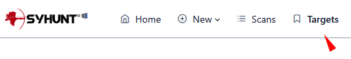
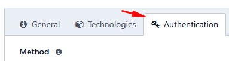
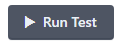
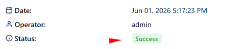
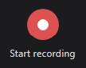
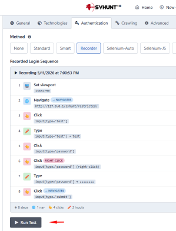

# Authenticated Scanning

> **Applies to:** Syhunt Dynamic 7.2.0.24

**Contents**

- [Introduction](#intro)
- [Available authentication methods](#methods)
- [What's new in version 7.2](#whatsnew)
- [Configuring and testing authentication](#auth_various)
- [Recording a login sequence (Recorder)](#auth_recorder)
- [Scanning with a manual login (Sandcat)](#auth_manual)
- [Selenium-based authentication](#auth_selenium)
- [Scheduled scans with authentication](#auth_scheduled)
- [Authenticated scans from the command line](#auth_cli)
- [Customizing form auto-completion](#autocomplete)
- [Preventing accidental logout](#prevlogout)
- [Using client SSL certificates](#clientcerts)

<a id="intro"></a>

## Introduction

Since version 7.2, Syhunt Dynamic supports a wide range of authentication methods: **Standard**, **Recorder**, **Selenium-Auto**, **Selenium-JS**, **Smart**, **Basic**, **Bearer**, **Digest**, **NTLM** and **Manual**.

Most methods are automated: Syhunt Dynamic logs in using the credentials and settings configured on the Target Preferences screen. Depending on the method, it detects the login form automatically, replays a recorded browser login, runs a Selenium script or uses an HTTP authentication mechanism. Where the method supports it, Syhunt Dynamic monitors the authenticated session and logs in again automatically if the session is lost.

**Manual authentication** starts a scan from a browser session you've already logged into in Edge or Chrome, using the Syhunt Sandcat browser extension. Syhunt Dynamic monitors that session throughout the scan and reports whether it was lost before the scan finished.

<a id="methods"></a>

## Available authentication methods

| Method | Description |
|---|---|
| **None** | Authentication is disabled. |
| **Standard** | Classic form-based login using direct HTTP requests, without a browser session. |
| **Smart** | Tries Selenium-Auto first and falls back to Standard if needed. |
| **[Recorder](#auth_recorder)** | Replays a login sequence recorded in Edge, Chrome or another Chromium-based browser. |
| **[Pre (Manual)](#auth_manual)** | Uses a browser session you logged into in Edge or Chrome, through the Syhunt Sandcat extension. Unlike the other methods, it's started from Sandcat rather than configured on the Target Preferences screen. |
| **[Selenium-Auto](#auth_selenium)** | Automatically generates and runs a Selenium login script. No coding required. |
| **[Selenium-JS](#auth_selenium)** | Runs a custom Node.js login script that you provide. For security reasons, scripts can only be entered through the CLI. |
| **Bearer** | Authenticates requests with a bearer token. Common in REST services, web APIs, mobile apps and modern web applications. |
| **Basic** | HTTP Basic authentication. |
| **Digest** | HTTP Digest authentication. |
| **NTLM** | NTLM authentication, common in Windows and Active Directory environments. |

<a id="whatsnew"></a>

## What's new in version 7.2

Version 7.2 introduces **Syhunt Authenticator 2.0**, a major redesign of Syhunt Dynamic's authentication framework.

- **One module for every method.** The authenticator used to handle mainly Selenium-based logins. It now manages all authentication methods, for a more consistent configuration experience.
- **One place to configure it.** Settings previously split between web form authentication and server-side methods (Basic, Digest, NTLM) are now together on the Target Preferences screen.
- **New methods:**
  - **Recorder**: records and replays browser-based login sequences.
  - **Smart**: combines Selenium-Auto and Standard for better compatibility.
  - **Selenium-Auto**: generates and runs Selenium login scripts with no code to write.
  - **Selenium-JS**: runs custom login scripts written in Node.js.
- **Removed methods.** The legacy **Selenium-Python** and **AI-Powered** methods are gone. You no longer need to install and maintain a separate Python environment and third-party dependencies, which also reduces exposure to external components and software supply-chain attacks. Selenium-Auto replaces AI-Powered login and works in much the same way, without requiring Python or an AI integration.

The result is an authentication setup that is simpler, more secure and better integrated with the Syhunt Dynamic scanning workflow.

<a id="auth_various"></a>

## Configuring and testing authentication

1. Open the **Targets** screen in the Web UI.<br>
2. Add the URL to the list of targets, if it isn't there yet.<br>
3. Open the target and go to the **Authentication** tab.<br>
4. Select the authentication method.
5. Enter the credentials.
6. Click **Run Test** to check that authentication works.<br>
   - On success, you'll see a **Success** message and a screenshot of the page after login.<br>
   - On failure, you'll see a **Failed** message and a debug log.

For method-specific instructions, see [Recorder](#auth_recorder), [Selenium](#auth_selenium) or [Manual login](#auth_manual).

<a id="auth_recorder"></a>

## Recording a login sequence (Recorder)

With the **Recorder** method, Syhunt Dynamic logs in by replaying a login you recorded in Edge, Chrome or another Chromium-based browser. Instead of writing a script, you record yourself logging in, export the recording as JSON and paste it into the Target Preferences screen. Syhunt Dynamic replays the recorded steps whenever it needs to log in during a scan.

> [!NOTE]
> **Linux users:** don't use Backspace to correct typing mistakes while recording. If you mistype, start the recording over. In our tests, recordings containing Backspace keystrokes sometimes failed to replay on Linux.

**1. Record the login**

1. In Edge, Chrome or another Chromium-based browser, go to the website you want to scan.
2. Right-click the page and choose **Inspect** (at the bottom of the menu).<br>
3. Open the **Recorder** tab.<br>
4. Click **Create recording**.<br>
5. Enter a name for the recording and click the red **Start recording** button.<br>
6. Log in as usual.
7. When you're done, click **End recording**.<br>
8. Log out and click **Replay** at the top to confirm the recording replays correctly.<br>
9. Click **Show code** on the right side of the screen.<br>
10. Select the JSON code manually, right-click it and choose **Copy**.

    > [!TIP]
    > Don't use *Select all* followed by *Copy*: a small Chrome UI bug prevents the whole JSON from being selected.

**2. Add the recording to Syhunt**

1. Open the **Targets** screen in the Web UI.<br>
2. Add the login URL to the list of targets, if it isn't there yet.<br>
3. Open the target and go to the **Authentication** tab.<br>
4. Select **Recorder**.
5. Paste the JSON into the **Recorded Login Sequence** field.<br>
6. Click **Run Test** to confirm that Syhunt can replay the recording.<br>

<a id="auth_manual"></a>

## Scanning with a manual login (Sandcat)

With the Syhunt Sandcat extension installed in your browser (Edge, Chrome, Brave or another Chromium-based browser), you can start a scan directly from the browser, using the session you established by logging in to the target website.

1. Make sure the [Syhunt Sandcat](../installation/install-windows.md#sandcat) extension is installed and enabled.
2. In the browser, go to the website you want to scan.
3. Log in with your credentials.
4. Click the Sandcat icon in the browser toolbar, then **Scan This Site**.<br>
5. A new screen opens. A green **Session Ready** message confirms that the session was captured.
6. Click **Start Scan**.

The session details section of the report shows whether the manually started session lasted from the beginning to the end of the scan (**Authenticated Session Maintained: Yes**).

<a id="auth_selenium"></a>

## Selenium-based authentication

**1. Configure the target**

1. Open **Targets** from the top menu.<br>
2. Add the URL to the list of targets, if it isn't there yet.<br>
3. Click the URL. The Target Preferences screen opens.
4. On the **Authentication** tab, select **Selenium-Auto** or **Selenium-JS**. Selenium-Auto generates the script for you; Selenium-JS runs a script you write.
5. Enter the username and password.
6. Click **Save**. The Target Preferences window closes.
7. If you chose **Selenium-JS**, enter your script through the [CLI](../integrations/command-line.md), for example:

   ```
   scancore -tg:http://yourtargetapp.com -prefset:dynamic.formauth.script.seleniumjs.encrypted -fromfile:path/to/myseleniumscript.js
   ```

   When writing the script:
   - Start at the part that fills in and submits the login form.
   - Don't call `driver.get()` at the start or `driver.quit()` at the end; Syhunt handles both.
   - Use the placeholders `@user@` and `@pass@` for the username and password entered on the Authentication tab, for example `username_field.sendKeys('@user@')` and `password_field.sendKeys('@pass@')`.

**2. Test it**

1. Click the configured URL again and click **Run Test**.<br>
2. If you see **Successful login** and a screenshot of the logged-in page at the top of the screen, the configuration is ready for future scans.
3. If it keeps failing after several retries, adjust your Selenium script and try again.

Reports from authenticated scans include, at the top, a screenshot of the target after login and an indication of whether the session was maintained from start to finish.

<a id="auth_scheduled"></a>

## Scheduled scans with authentication

1. Open the **Scans** screen and click **Scheduled Scans**.
2. Click a scheduled dynamic scan, then the **Preferences** button next to the target field.
3. On the **Authentication** tab, choose the authentication method and enter the credentials.

<a id="auth_cli"></a>

## Authenticated scans from the command line

There are two approaches:

- **A.** Pass the credentials to `scanurl` when you launch the scan.
- **B.** Store the credentials beforehand with `scancore`.

Method B is more secure, because the password isn't exposed on the `scanurl` command line.

```lua
-- Method A: form authentication specified when launching the scan.
-- The credentials are not stored in the Dynamic settings.
scanurl http://127.0.0.1 -atype:Form -auser:yourusername -apass:yourpassword

-- Method B: authentication stored for a specific website.
-- The credentials are saved in the Dynamic settings and reused in every scan of this target.
-- Available types: None, Smart, Standard, Basic, Bearer, Digest and Selenium-Auto.
-- None disables authentication.
scancore -tg:http://127.0.0.1 -prefset:dynamic.formauth.type -v:Standard
scancore -tg:http://127.0.0.1 -prefset:dynamic.formauth.username -v:myuser
scancore -tg:http://127.0.0.1 -prefset:dynamic.formauth.password -vsecret
-- For Bearer authentication, set the token instead:
scancore -tg:http://127.0.0.1 -prefset:dynamic.formauth.token -vsecret
scanurl http://127.0.0.1
```

`-vsecret` prompts you (twice, with masked input) for the value, so it never appears on the command line. See [Preferences](../reference/preferences.md).

<a id="autocomplete"></a>

## Customizing form auto-completion

> [!NOTE]
> This applies to the **Standard**, **Smart** and **Selenium-Auto** methods, and is mainly intended for advanced scenarios.

Syhunt Dynamic detects and fills in login form fields automatically in most applications. You only need to configure fields manually when a form uses non-standard field names, custom controls or extra fields that can't be identified automatically.

For example, this form has an extra hidden field and non-standard names:

```html
<input name="ClientUTBox" id="ClientUTBox" type="hidden" value="1234">
<input name="ClientUNBox" id="ClientUNBox" type="text" class="InputBox"/>User Name
<input name="ClientPWBox" id="ClientPWBox" type="password" class="InputBox">Password
```

To tell Syhunt how to fill it in:

1. Open **Targets** from the top menu.<br>
2. Click the target URL (it must already be in the list). The Target Preferences screen opens.
3. On the **Authentication** tab, click **Optional** to show the additional options.
4. Click **Custom Fields** and add these lines:

   ```
   ClientUTBox=1234
   ClientUNBox=@syhunt_web_form_username
   ClientPWBox=@syhunt_web_form_password
   ```
5. Click **Save** to save the custom fields, then **Save** at the bottom of the screen.

Alternatively, set the same fields from the command line:

```
scancore -tg:"[targeturl]" -prefset:dynamic.formauth.fields.encrypted -v:[ClientUTBox=1234],[ClientUNBox=@syhunt_web_form_username],[ClientPWBox=@syhunt_web_form_password]
```

Values that start with `@` are internal variables: they insert the username and password entered on the Target Preferences screen into those fields. When you're done, click **Run Test** to confirm that login works with the configured credentials and custom fields.

<a id="prevlogout"></a>

## Preventing accidental logout

Syhunt Dynamic detects most logout pages and avoids them while crawling. If it does hit one, it can usually log in again automatically and carry on.

For applications with custom logout URLs or unusual logout mechanisms, you can list the logout pages so the crawler avoids them altogether:

1. Open the **Targets** screen.<br>
2. Open the target.
3. Go to the **Crawling** tab.
4. Under **Exclusions**, click **Logout URLs** and add your logout URL, for example `/getmeout.php`.
5. Click **Save**. The dialog closes.

<a id="clientcerts"></a>

## Using client SSL certificates

If the target requires client SSL certificates, configure them as follows:

1. Open **Admin → Connectors**.
2. Click **Add**.
3. Set **Type** to **Web Certificate**, enter a name for the certificate and click **Create**.
4. Click the new certificate in the list. The Web Certificate screen opens.
5. Select the certificate files and click **Save**.
6. Open the **Targets** screen and click the website that needs the certificate. The Target Preferences screen opens.
7. On the **Advanced** tab, under **Certificate**, select the certificate from the list.
