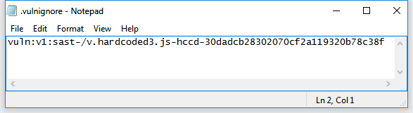

# Source Code Scanning (SAST/MAST)

> **Applies to:** Syhunt Code 7.2

**Contents**

- [How to perform a code scan](#code_begin)
- [Supported languages](#languages)
- [Scanning from the command line](#cli)
- [Preventing antivirus interference in pipelines](#advanced_pipeline)
- [Preventing a vulnerability from being reported](#advanced_vulnignore)
- [Related guides](#related)

## How to perform a code scan

Syhunt's white-box scan (source code scan) uncovers many classes of application vulnerabilities and highlights areas of the code that need review. Its static analysis detects a very large number of vulnerability types, including the 2025 CWE Top 25 Most Dangerous Software Weaknesses and the OWASP Mobile Top 10 risks, across many web and mobile programming languages.

### Supported languages: web

| Language | Frameworks and variants |
|---|---|
| C# | Blazor, Razor Pages, ASP.NET Core MVC, ASP.NET Web Forms |
| ASP Classic | VBScript and JavaScript |
| Dart | |
| Java | JEE / JSP |
| JavaScript | Client and server side, Node.js, Angular, AngularJS, React, Express.js, Koa.js |
| Kotlin | Ktor |
| Lua | ngx_lua, mod_lua, CGILua, Lua Pages |
| Object Pascal | Delphi XE and older, Lazarus, DWS |
| Perl | Mojolicious, PSGI/Plack, CGI |
| PHP | |
| Python | CGI, Django, mod_python, WSGI |
| Ruby | Rails, ERB |
| TypeScript | Client and server side, Node.js, Angular |
| VB | VB.NET, ASP.NET Web Forms |

### Supported languages: mobile

| Language | Platform |
|---|---|
| Java | Android |
| Kotlin | Android |
| Swift | iOS |
| Objective-C, C and C++ | iOS |
| C# | .NET MAUI, Xamarin (Android/iOS) |
| Dart | Flutter (Android/iOS) |
| Object Pascal | Delphi XE |
| JavaScript | Including Node.js, Angular, AngularJS, Express.js, Koa.js |

### Running the scan

Follow these steps to run a source code scan and generate a vulnerability report:

1. [Enable the Web UI](../installation/web-ui.md#firststeps), if you haven't done so yet.
2. In the Syhunt Web UI, click Code's **New Scan** button. 
3. Enter the project URL, or the file to scan.
4. *(Optional)* If you entered a project URL, you can also enter a branch name. If you leave it blank, the main branch is used.
5. Select a scan method. We recommend **Application Code Scan (Default)**, which checks for all vulnerabilities using the recommended settings. The methods are explained in [Hunt Methods](hunt-methods.md).
6. Click **Start Scan**.

When the scan finishes, click **View Report** to open the results as an HTML report, or **Export** to download them in your preferred format.

### Scanning from the command line

See [Command Line: code scans](../integrations/command-line.md#cli_code_begin).

## Preventing antivirus interference in pipelines

When analyzing a large codebase, Syhunt opens every file in the repository. If real-time antivirus protection is enabled, the antivirus also scans each of those files, which can slow the scan down considerably.

In our tests on a machine running Microsoft Defender, scanning a PHP repository of about 10,000 files took 10 minutes longer and used 25% more CPU because of the Antimalware Service (`MsMpEng.exe`). In a CI/CD pipeline, those 10 minutes matter.

The fix is to add a **Process** exclusion in Defender. A process exclusion stops the antivirus from scanning the files that the Syhunt process opens; a *file* exclusion, by contrast, only excludes the executable itself.

To add a process exclusion in Microsoft Defender:

1. Open **Start → Settings**.
2. Under **Privacy & security**, select **Virus & threat protection**.
3. Under **Virus & threat protection settings**, select **Manage settings**.
4. Under **Exclusions**, select **Add or remove exclusions**, then choose **Process**.
5. Enter the full path of the Syhunt Code scanner, `C:\Program Files\Syhunt Hybrid\ScanCode.exe`, and click **Add**.

If you use another antivirus product, see its documentation for the equivalent setting.

## Preventing a vulnerability from being reported

To suppress specific findings, create a `.vulnignore` file in the root of the repository or directory being scanned. Put one ignore ID or ignore rule per line.

Each vulnerability entry in a report ends with its ignore ID. Ignore IDs are the simplest and recommended way to suppress a finding. For broader scenarios, you can write [ignore rules](ignore-rules.md) instead.

## Related guides

- [Hunt Methods](hunt-methods.md): choose the right scan method.
- [Scheduling Scans](scheduling.md): run scans automatically.
- [Reporting](reporting.md): customize reports.
- [Technical Specifications](../reference/technical-specifications.md#specsbegin): system requirements.
