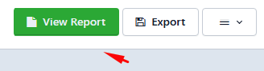
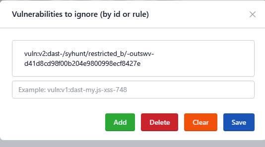

# Dynamic Scanning (DAST)

> **Applies to:** Syhunt Dynamic 7.2

**Contents**

- [How to perform a dynamic scan](#dynamic_begin)
- [Logging in manually through the browser](#manuallogin)
- [Scanning from the command line](#cli)
- [Scanning IPv6 addresses](#ipv6)
- [Preventing a vulnerability from being reported](#advanced_vulnignore)
- [Pre-scan requirements](#dynscanreq)
- [Related guides](#related)

<a id="begin"></a>
<a id="dynamic_begin"></a>

## How to perform a dynamic scan

In a standard dynamic scan (also known as a black-box scan), Syhunt injects data into the web application and then analyzes the responses to determine whether the code is vulnerable to specific web application attacks.

<a id="languages"></a>

### Main supported languages

ASP (Classic) · ASP.NET · Java / JSP · JavaScript · Lua · Perl · PHP · Python · Ruby

<a id="languagesend"></a>

### Running the scan

Follow these steps to run a dynamic scan and generate a vulnerability report:

1. ⚠️ Make sure you meet the [pre-scan requirements](#dynscanreq) and are authorized to scan the target.
2. [Enable the Web UI](../installation/web-ui.md#firststeps), if you haven't done so yet.
3. In the Syhunt Web UI, click Dynamic's **New Scan** button.<br>
4. Enter the URL of the website you want to scan.<br>
5. Select a scan method. We recommend **Application Scan (Default)**, which checks for all vulnerabilities using the recommended settings. The methods are explained in [Hunt Methods](hunt-methods.md).
6. *(Optional)* Click **Preferences**. On the **Technologies** tab, select the technologies used by the target website. You can change other site-specific preferences on the same screen. Review the settings and click **Save**.
7. Click **Start Scan**.

When the scan finishes, click **View Report** to open the results as an HTML report, or **Export** to download them in your preferred format.



<a id="manuallogin"></a>

### Logging in manually through the browser

See [How to perform a manual authenticated scan with Syhunt Sandcat](authenticated-scanning.md#auth_manual).

<a id="cli"></a>

### Scanning from the command line

See [Command Line: dynamic scans](../integrations/command-line.md#cli_dynamic_begin).

<a id="ipv6"></a>

### Scanning IPv6 addresses

Syhunt Dynamic fully supports IPv6 targets. Enclose the address in square brackets, for example:

```
http://[2001:4860:0:2001::68]/index.php
```

<a id="advanceddyn"></a>
<a id="advanced_vulnignore"></a>

## Preventing a vulnerability from being reported

You can stop specific vulnerabilities from being reported by using ignore IDs or ignore rules:

1. Open **Targets** in the menu<br><br>and click the target in the list.
2. Go to the **Manage** tab.
3. In the **Exclusions** group, click **Vulnerabilities**.
4. Type the ignore ID or rule and click **Add**.



Each vulnerability entry in a report ends with its ignore ID. Ignore IDs are the simplest and recommended way to suppress a finding. For broader scenarios, you can write [ignore rules](ignore-rules.md) instead.

For common questions, see the [FAQ](../getting-started/faq.md#dynamic_begin).

<a id="dynscanreq"></a>
<a id="dynscanreq_begin"></a>

## Pre-scan requirements

1. ⚠️ **Only system administrators, or other people in charge of the target, should use this software. Do not scan websites outside your direct control.**
   - If you need to scan a website you don't control, obtain written permission from its owner or administrator first.
   - As good practice, back up the website's source code and database before scanning. In rare cases, injection testing against an insecure, fragile website can pollute the database or alter files in ways that affect how the site works.
2. Make sure you meet the [Internet connection requirements](../installation/install-windows.md#sysreq_net).
3. Read and accept the [Syhunt EULA](https://www.syhunt.com/en/?n=Legal.EULA) before launching any scan.

<a id="dynscanreq_end"></a>
<a id="related"></a>

## Related guides

- [Hunt Methods](hunt-methods.md): choose the right scan method.
- [Authenticated Scanning](authenticated-scanning.md): scan areas behind a login.
- [Scheduling Scans](scheduling.md): run scans automatically.
- [Reporting](reporting.md): customize reports.
- [Technical Specifications](../reference/technical-specifications.md#specsbegin): system requirements.
