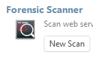
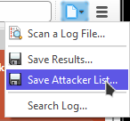

# Forensic Log Analysis

> **Applies to:** Syhunt Forensic 7.0.13

> [!IMPORTANT]
> In Syhunt Hybrid 7.2, Forensic is available only from the command line (the `scanlog` command; see the [Command Line guide](../integrations/command-line.md)). A future update will make it available from the Web UI again. The interface steps below apply to earlier versions.

## Introduction

Syhunt Forensic (formerly Syhunt Insight) investigates web application compromises and helps prevent future breaches. It quickly and accurately identifies the source, type and methods of an attack, so organizations can close the gaps and defend against further threats.

Syhunt Forensic is not a standalone product. It complements Syhunt's dynamic (DAST) and static (SAST) testing tools by focusing on post-incident analysis and breach investigation: while DAST and SAST find and fix vulnerabilities during development and deployment, Forensic shows in detail what happened in attacks that have already taken place. Together they cover both prevention and response.

## Supported log formats

Syhunt Forensic reconstructs attack sessions from the logs of popular web servers. It relies on the details these logs record to tell legitimate traffic from malicious traffic, and automated attacks from manual ones, so it needs access to them:

- Apache
- Nginx
- Microsoft IIS
- Lighttpd

## Running a forensic scan

1. Launch Syhunt Hybrid and click the Syhunt Forensic icon, or **New Scan**, on the welcome page. 
2. Select the web server log file to analyze. This is usually a file with a `.log` extension, such as `access.log`, or a file whose name starts with `access_log` and has no extension.
3. Wait for the scan to finish.

When the scan ends, the log gets one of these statuses:

| Status | Meaning |
|---|---|
| 🟢 **No attacks** | No application security attacks were found in the log. |
| 🟠 **Attack Attempts Found** | There are signs of possible attacks, but no confirmed breach. |
| 🔴 **Breached** | There are signs of possible attacks **and** of a successful breach. |

Click **Save Results**  in the toolbar to save the list of attempted attacks.

## Reconstructing an attacker's session

Syhunt Forensic can reconstruct entire attack sessions from the log, separating legitimate from malicious traffic and automated from manual attacks. This helps you understand the full scope of an incident.

1. Double-click an attack in the list.
2. In the bottom bar, click **View All Requests**.
3. A new tab opens. Wait for the reconstruction to finish.

## Exporting the attacker list

You can export the IP addresses identified as attackers and use the list to harden your firewall rules, blocking those addresses proactively to prevent further attacks from the same sources.

When the scan has finished, click the file icon shown below and choose **Save Attacker List**.

## Excluding IP addresses from the analysis

1. Click **Preferences**. 
2. Go to the **Exclusions** tab.
3. Click **Source IPs**.
4. Add the IP addresses to ignore, or import them from a file.
5. Click **OK** to save the list, then **OK** again to close the preferences dialog.
6. Run the scan again.
