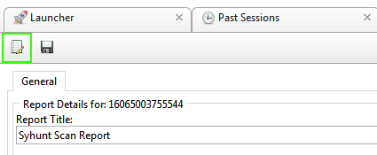

# Reporting

> **Applies to:** Syhunt Hybrid 6.9

## Customizing reports

Before saving a report, you can choose its language and add your organization's logo. The settings apply to every report you generate from then on.

1. Click **Edit Report Preferences** in the toolbar. The **Report Preferences** dialog opens. 
2. Enter the URL of the image that contains your logo. 
3. Choose the output language.
4. Click **OK** to save.

Reports you generate from now on will show your organization's logo instead of Syhunt's.

## Exporting results

When a scan finishes, click **Export** on the scan results screen to download the results in your preferred format. For the full list of report and export formats, see [Technical Specifications](../reference/technical-specifications.md).
